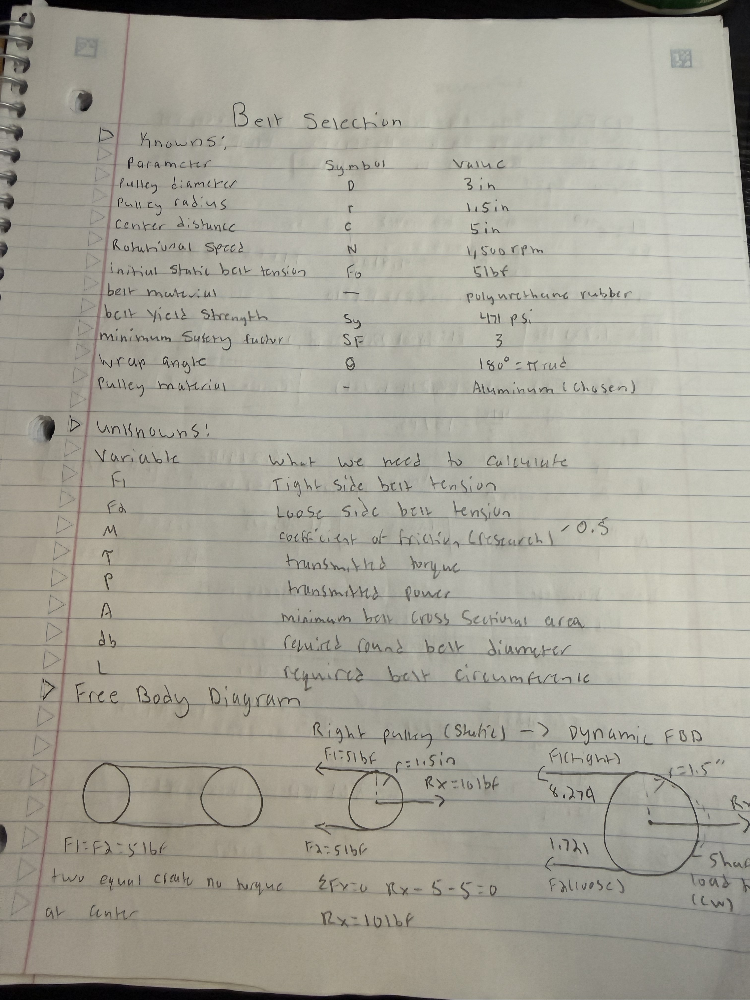

# A9 – Pulleys

## Objective

The objective of this assignment was to design and analyze a pulley system capable of transferring rotational power between two parallel shafts. The design required the application of engineering principles involving statics, dynamics, friction, stress analysis, and material selection.

The pulley system was required to meet several design constraints:

- **Pulley Diameter:** Two pulleys, each measuring 3 inches in diameter.
- **Center Distance:** 4–6 inches between the pulley shafts.
- **Rotational Speed:** Operating speed between 1,000 and 2,000 RPM.
- **Static Belt Tension:** Between 4 and 6 lbf.
- **Pulley Materials:** Aluminum, ABS, or steel.
- **Belt Material:** Polyurethane rubber with an assumed yield strength of 471 psi.
- **Safety Factor:** Minimum factor of safety of 3.

The design process involved calculating belt tensions, selecting an appropriate round belt, determining the minimum shaft diameter, selecting journal bearings, and designing a frame to support the entire system.

SolidWorks was used to create a preliminary 3D assembly consisting of two pulleys, shafts, bearing supports, a base plate, and a connecting belt.

The overall goal was to develop a mechanically reasonable pulley system while demonstrating how engineering calculations and design decisions contribute to the development of a functional mechanical assembly.

## Analyze

### Part 1 — Belt Design and Selection

The first stage of the analysis focused on determining the forces acting on the polyurethane belt and selecting an appropriate belt diameter. I began by identifying the known design parameters and the unknown values that needed to be calculated.

For the preliminary design, I selected two 3-inch-diameter pulleys with a center distance of 5 inches, an operating speed of 1,500 RPM, and an initial belt tension of 5 lbf. These values were selected within the ranges specified in the assignment.

#### Known and Unknown Values

The known values included the pulley diameter, pulley radius, center distance, rotational speed, initial belt tension, belt yield strength, and minimum required factor of safety.

The unknown values included the tight-side and loose-side belt tensions, transmitted torque, power, minimum belt cross-sectional area, minimum belt diameter, and required belt circumference.

#### Static and Dynamic Free-Body Diagrams

I first constructed a static free-body diagram to analyze the forces acting on the pulley before power transmission. Under static conditions, the two belt tensions are equal, and the resulting belt torque is zero.

Next, I developed a dynamic free-body diagram to represent the system while transmitting power. During operation, the tight-side belt tension becomes greater than the loose-side tension. This difference in tension produces the torque transmitted through the pulley.

#### Belt Force and Friction Analysis

To determine the maximum belt tensions before slipping, I used the belt friction relationship presented in the lecture.

A preliminary coefficient of friction of 0.50 was selected for polyurethane contacting aluminum. The wrap angle was 180 degrees because the two pulleys have equal diameters in an open-belt arrangement.

Using the friction relationship and the initial belt tension, I calculated a maximum tight-side tension of approximately 8.279 lbf and a loose-side tension of approximately 1.721 lbf.

These forces were then used to calculate the theoretical maximum transmitted torque of 9.837 lbf·in and power of approximately 174.6 W at 1,500 RPM.

#### Belt Stress and Diameter

The next step was to determine the minimum belt cross-sectional area required to satisfy the factor of safety of 3.

Using the specified polyurethane yield strength of 471 psi, I calculated an allowable tensile stress of 157 psi.

The maximum tight-side tension was used to determine the minimum required cross-sectional area and the corresponding diameter for a circular belt.

The calculated minimum diameter was approximately 0.259 inches. I selected a standard 5/16-inch polyurethane round belt, which produced a preliminary tensile safety factor of approximately 4.36.

#### Belt Circumference and Selection

After selecting the belt diameter, I calculated the required belt length using the pulley diameter and shaft center distance.

The calculated installed belt circumference was approximately 19.425 inches, assuming a 3-inch effective pulley diameter.

Using preliminary manufacturer load-elongation data, I estimated an unstretched belt length of 18.257 inches to generate the selected initial tension. This length requires verification for the final purchased belt and pulley groove geometry.

#### Belt Analysis Conclusion

The preliminary analysis resulted in the selection of a 5/16-inch polyurethane round belt. The belt satisfied the required tensile factor of safety under the simplified loading assumptions.

The calculated forces and transmitted torque also provided the loading information needed for the subsequent shaft and bearing analyses.

### Part 2 — Shaft Design and Analysis

The second stage of the analysis focused on determining the minimum shaft diameter required to withstand the torque transmitted by the pulley system.

The shafts were designed using AISI 1060 hardened steel, as specified in the assignment. I used the torque calculated during the belt analysis to evaluate the torsional shear stress and determine an appropriate shaft diameter.

#### Known and Unknown Values

The known values included:

- **Shaft Material:** AISI 1060 hardened steel
- **Applied Torque:** 9.837 lbf·in
- **Assumed Yield Strength:** 97,000 psi
- **Required Safety Factor:** 3

The yield strength was selected based on a documented heat-treatment condition for AISI 1060 steel.

The unknown values included the minimum shaft diameter, maximum torsional shear stress, and actual factor of safety.

#### Shaft Free-Body Diagram

I constructed a free-body diagram showing the torque transmitted through the shaft.

The shaft was modeled under steady operating conditions, with the applied torque balanced by an equal and opposite resisting torque.

This free-body diagram helped establish the relationship between the torque applied to the shaft and the internal torsional loading.

#### Symbolic Shaft Analysis

To determine the minimum shaft diameter, I began with the torsional shear stress equation for a solid circular shaft.

The shaft's polar moment of inertia and outer radius were substituted into the equation to express the maximum shear stress in terms of torque and shaft diameter.

I then applied the von Mises yield criterion and the required factor of safety to derive an equation for the minimum shaft diameter.

The symbolic derivation was completed before numerical values were substituted, allowing the relationship between torque, material strength, shaft geometry, and safety factor to be established.

#### Numerical Shaft Analysis

After deriving the symbolic equation, I substituted the applied torque of 9.837 lbf·in, the assumed yield strength of 97,000 psi, and the required safety factor of 3.

The resulting minimum shaft diameter was approximately **0.139 inches**.

Since this value was not the preferred practical shaft size, I selected a **3/16-inch (0.1875-inch) solid steel shaft**.

Using the selected diameter, I recalculated the torsional stress and obtained a preliminary factor of safety of approximately **7.37**.

This exceeded the minimum required factor of safety of 3.

#### Shaft Design Conclusion

Based on the torsional analysis, a 3/16-inch solid AISI 1060 hardened-steel shaft was selected for the pulley system.

The selected shaft diameter exceeded the calculated minimum and satisfied the required factor of safety under the simplified torsional loading model.

The same shaft dimensions were used for both pulleys to simplify the design and assembly.

The analysis assumed a solid shaft under pure torsion. Additional analysis would be required to evaluate bending stresses, fatigue, and stress concentrations if keyways or other shaft-mounted features were added.

### Part 3 — Journal Bearing Design and Analysis

The third stage of the analysis focused on selecting journal bearings capable of supporting the rotating shafts while minimizing friction and wear.

Journal bearings were needed because the steel shafts rotate within the stationary bearing supports. Rather than allowing the shafts to rotate directly against the aluminum supports, I selected bronze bushings to provide a suitable bearing surface.

The analysis involved determining the bearing reaction forces, calculating the bearing pressure and shaft surface velocity, and evaluating the pressure-velocity (PV) rating to select an appropriate bearing material.

#### Known and Unknown Values

The known values included:

- **Shaft Diameter:** 0.1875 inches
- **Rotational Speed:** 1,500 RPM
- **Total Belt Load per Shaft:** 10 lbf
- **Number of Bearings per Shaft:** 2
- **Proposed Bearing Length:** 0.250 inches
- **Bearing Type:** Plain sleeve journal bearing

The unknown values included the reaction force at each bearing, projected bearing pressure, shaft surface velocity, PV value, and suitable bearing material.

#### Journal Bearing Free-Body Diagram

I began by constructing a free-body diagram of the shaft and its two bearing supports.

The pulley was assumed to be positioned midway between the two supports, allowing the applied belt load to be distributed equally between the bearings.

Using the equations of static equilibrium, I calculated the reaction forces at both supports.

The total transverse load was approximately 10 lbf, resulting in a reaction force of **5 lbf at each bearing** under the assumed symmetric loading conditions.

These reaction forces were used in the subsequent bearing pressure calculations.

#### Symbolic Bearing Analysis

After determining the bearing reaction forces, I developed the equations needed to evaluate bearing performance.

The first calculation involved the projected bearing pressure, which depends on the applied load, shaft diameter, and bearing length.

Next, I determined the surface velocity of the rotating shaft using its diameter and rotational speed.

Finally, I combined the pressure and velocity to calculate the PV value. This quantity is used to evaluate whether a journal bearing material can operate under the specified combination of loading and sliding speed.

Completing the symbolic analysis first allowed me to identify the important design variables before substituting the numerical values.

#### Numerical Bearing Analysis

Using the calculated reaction force of 5 lbf, a shaft diameter of 0.1875 inches, and a proposed bearing length of 0.250 inches, I determined the projected bearing pressure.

The resulting pressure was approximately **106.67 psi**.

I then calculated the shaft surface velocity at the selected operating speed of 1,500 RPM.

The resulting surface velocity was approximately **73.63 ft/min**.

Multiplying the pressure and velocity produced a PV value of approximately **7,854 psi·ft/min**.

These results were used to evaluate potential bearing materials.

#### Journal Bearing Material Selection

Based on the calculated operating conditions, I selected **SAE 841 oil-impregnated sintered bronze** as the preliminary journal bearing material.

This material was selected because its porous bronze structure retains lubricating oil, making it useful for rotating shafts operating under moderate loads and speeds.

Representative manufacturer material ratings for oil-impregnated bronze include:

- **Maximum Pressure:** 2,000 psi
- **Maximum Velocity:** 1,200 ft/min
- **Maximum PV:** 50,000 psi·ft/min

The calculated operating values were below these representative limits.

A nominal bearing size of **3/16-inch inside diameter, 1/4-inch outside diameter, and 1/4-inch length** was selected for the preliminary design.

The final bearing fit, actual dimensional tolerances, and the material ratings in the assigned Machinery's Handbook table would need to be confirmed before manufacturing.

#### Journal Bearing Analysis Conclusion

Based on the preliminary calculations, oil-impregnated SAE 841 bronze was selected as a suitable material for the journal bearings.

The calculated pressure, surface velocity, and PV value were all below the representative manufacturer material limits, supporting the preliminary selection.

The proposed design uses **four journal bearings**, with two supporting each shaft.

Although the bearing locations and support holes were incorporated into the SolidWorks assembly, the individual bronze bushings were not added as separate CAD components. This could be completed during further development of the assembly.

### Part 4 — Frame Design and Mechanical Analysis

The final stage of the analysis focused on designing a frame capable of supporting both pulley shafts and maintaining the required distance between them.

The frame needed to provide sufficient clearance for the rotating pulleys, maintain proper shaft alignment, and withstand the forces transmitted through the belt and journal bearings.

I decided to use a rectangular aluminum base plate with four individual bearing supports. This configuration allows each shaft to be supported at two locations while keeping the overall assembly relatively simple.

#### Frame Geometry and Material Selection

I selected aluminum 6061-T6 for the frame because of its relatively high strength, low weight, corrosion resistance, and machinability.

The preliminary frame dimensions were:

- **Base Plate:** 9.00 × 4.00 × 0.250 inches
- **Bearing Support Height:** 2.75 inches
- **Bearing Support Width:** 0.75 inches
- **Bearing Support Thickness:** 0.250 inches
- **Shaft Center Height:** 2.25 inches above the base
- **Distance Between Shaft Centers:** 5.00 inches
- **Number of Bearing Supports:** 4

The shaft center height was selected to provide clearance between the 3-inch-diameter pulleys and the base plate.

Each bearing support also included a mounting foot extending approximately 0.75 inches to allow the supports to be secured to the base.

#### Frame Free-Body Diagram

To evaluate the frame's strength, I developed a simplified free-body diagram of an individual bearing support.

From the previous journal bearing analysis, each bearing was assumed to experience a reaction force of approximately 5 lbf.

For the preliminary frame analysis, I modeled one upright support as a cantilever beam fixed at its base, with a horizontal force applied at the shaft center.

The force produces a bending moment at the bottom of the support.

This simplified model was used to estimate the maximum bending stress in the upright and determine whether the selected aluminum dimensions could withstand the applied loading.

#### Symbolic Frame Analysis

I began the analysis by calculating the bending moment generated by the force acting at the bearing center.

Next, I determined the area moment of inertia for the rectangular support cross-section.

The bending stress equation was then used to relate the applied bending moment to the support geometry.

Finally, I compared the resulting stress with the assumed yield strength of aluminum 6061-T6 to calculate the preliminary factor of safety.

This analysis allowed me to evaluate the selected support dimensions before considering additional details such as mounting holes and fasteners.

#### Numerical Frame Analysis

Using an applied force of 5 lbf and a shaft center height of 2.25 inches, I calculated a maximum bending moment of **11.25 lbf·in** at the base of the support.

For the assumed bending direction, I used a rectangular cross-section measuring 0.75 inches wide and 0.250 inches thick.

The resulting area moment of inertia was approximately **0.0009766 in^4**.

Using the flexure formula, I calculated a maximum bending stress of approximately **1,440 psi**.

With an assumed yield strength of 35,000 psi for aluminum 6061-T6, the preliminary factor of safety was approximately **24.3**.

This value exceeded the required minimum factor of safety of 3 under the simplified loading assumptions.

#### Frame Design in SolidWorks

After completing the preliminary calculations, I used SolidWorks to model the frame and establish the required pulley spacing.

I began by creating the rectangular base plate and extruding it to the selected thickness of 0.250 inches.

Next, I modeled an individual bearing support using the selected height, width, and thickness. A circular hole was added at the shaft center location to accommodate the planned journal bearing.

I also created an L-shaped mounting foot with two clearance holes to provide locations for securing the support to the base.

The bearing support was then inserted into the assembly four times.

I positioned the supports to create two sets of aligned bearing holes, one set for each shaft, while maintaining the required 5-inch distance between the shaft centerlines.

Finally, I added eight #6-32 UNC tapped mounting holes to the base at the support locations. The actual screws were not inserted into the CAD assembly.

#### Frame Analysis Conclusion

The preliminary frame analysis showed that the selected aluminum upright dimensions exceeded the required factor of safety of 3 under the assumed cantilever loading conditions.

The frame design also provided the necessary clearance and spacing for the two 3-inch pulleys.

The SolidWorks assembly demonstrated the intended arrangement of the base, shafts, and bearing supports.

However, this analysis was limited to a simplified bending model of an individual upright. Additional checks of mounting fasteners, support-foot geometry, deflection, and the complete frame would be necessary before manufacturing or operating the assembly under load.

## Decide

### Part 1 — Design Selection and Base Plate

After completing the preliminary engineering calculations, I began developing the pulley system in SolidWorks. The goal was to translate the calculated dimensions and selected materials into a 3D assembly that could demonstrate the intended arrangement of the mechanical components.

I selected a two-pulley, open-belt configuration because it allows rotational power to be transferred between parallel shafts while maintaining the same direction of rotation.

The preliminary design consisted of:

- Two 3-inch-diameter aluminum pulleys
- Two 3/16-inch-diameter steel shafts
- One 5/16-inch polyurethane round belt
- Four aluminum bearing supports
- Four proposed bronze journal bearings
- One rectangular aluminum base plate

The design used a 5-inch center distance between the pulleys and a selected operating speed of 1,500 RPM.

I chose to create the individual components as separate SolidWorks part files before combining them into an assembly. This approach allowed each component to be dimensioned and modified independently.

#### Step 1 — Creating the Base Plate

I began the CAD process by creating the base plate, which serves as the foundation of the pulley system.

I selected aluminum 6061-T6 as the intended frame material because of its strength-to-weight ratio, machinability, and suitability for structural components.

In SolidWorks, I created a new part and began a sketch on the Top Plane.

I used the Rectangle tool to create the base geometry and applied Smart Dimensions to define its length and width.

The selected base dimensions were:

- **Length:** 9.00 inches
- **Width:** 4.00 inches
- **Thickness:** 0.250 inches

The 9-inch length provided sufficient space for the selected 5-inch shaft center distance while leaving additional room for the supports.

The 4-inch width provided space to position two bearing supports along each shaft.

After fully defining the rectangle, I used the Extruded Boss/Base feature to extrude the sketch to a thickness of 0.250 inches.

#### Base Plate Design Decision

I chose a simple rectangular base rather than a more complex frame because the geometry was sufficient for the preliminary pulley system and simplified the assembly process.

The flat upper surface also provided a convenient location for mounting the four bearing supports.

Using a separate base component allowed the support locations and mounting holes to be added later in the assembly.

The completed part was saved as `A9_BASE.SLDPRT` for use in the main SolidWorks assembly.

### Part 2 — Bearing Support Design

After completing the base plate, I began designing the bearing supports that would hold the two rotating shafts in position.

The purpose of the bearing supports was to maintain shaft alignment, support the loads transmitted by the belt, and provide locations for the journal bearings.

I decided to use four identical bearing supports, with two supports for each shaft. This design simplified the modeling process because only one support needed to be created before inserting multiple copies into the assembly.

#### Step 2 — Creating the Upright Support

I started by creating a new SolidWorks part and sketching a rectangular profile for the upright support.

Using Smart Dimensions, I defined the geometry with the following dimensions:

- **Height:** 2.75 inches
- **Width:** 0.75 inches
- **Thickness:** 0.250 inches

After fully defining the sketch, I used Extruded Boss/Base to create the upright.

The support height was selected to position the shaft center 2.25 inches above the base plate, providing clearance for the 3-inch-diameter pulleys.

#### Step 3 — Creating the Journal Bearing Hole

Next, I added a circular opening to the upright support to accommodate the planned bronze journal bearing.

I created a sketch on the front face of the support and positioned the circle along its vertical centerline.

The hole was defined using the following dimensions:

- **Hole Diameter:** 0.250 inches
- **Horizontal Center Location:** 0.375 inches from the side
- **Vertical Center Location:** 2.25 inches from the bottom

I then used Extruded Cut to create the through-hole.

The 0.250-inch diameter was selected to correspond to the nominal outside diameter of the proposed bronze bushing. The exact hole tolerance and press fit would need to be verified before manufacturing.

#### Step 4 — Creating the Mounting Foot

To secure the bearing supports to the base plate, I added an L-shaped mounting foot to the bottom of the upright.

I created an additional sketch and used Extruded Boss/Base to extend the mounting geometry from the support.

The mounting foot was designed with:

- **Projection:** 0.75 inches
- **Width:** 0.75 inches
- **Thickness:** 0.250 inches

This feature provided a flat mounting surface and space for two fasteners.

The foot was merged with the upright to create a single SolidWorks part.

#### Step 5 — Creating the Mounting Holes

After creating the mounting foot, I added two clearance holes for the proposed mounting screws.

I selected the top face of the mounting foot, created a new sketch, and positioned two circles.

The holes were designed with a nominal diameter of 0.150 inches to provide clearance for #6-32 UNC screws.

Using Extruded Cut, I cut both holes through the mounting foot.

This configuration would allow the supports to be fastened to threaded holes in the base plate.

#### Bearing Support Design Decision

I selected identical L-shaped bearing supports because they provided a straightforward way to support the shafts while allowing the components to be modeled and assembled separately.

Using the same support geometry for all four locations also reduced the number of unique parts needed for the design.

The bearing hole provided the intended mounting location for an oil-impregnated bronze bushing, while the mounting foot allowed the support to be secured to the aluminum base plate.

During the preliminary CAD process, I also checked the orientation of the supports and adjusted their placement to ensure that the bearing holes would align with the shafts.

The completed part was saved and later inserted four times into the main assembly.

### Part 3 — Frame Assembly and Mounting Holes

After completing the individual base plate and bearing support components, I began creating the main pulley system assembly in SolidWorks.

The purpose of this stage was to position the four supports accurately, establish the required shaft spacing, and prepare the base for mounting hardware.

#### Step 6 — Creating the Assembly

I began by opening a new SolidWorks assembly and inserting the base plate as the first component.

The base was fixed in position to provide a stable reference for the remaining components.

Next, I inserted four copies of the bearing support part. I chose to reuse the same support design because all four supports required identical dimensions and bearing-hole locations.

I used SolidWorks assembly mates to position the supports on the upper surface of the base plate.

#### Step 7 — Positioning and Aligning the Supports

The next step was to establish the correct positions of the four supports.

Two supports were assigned to each shaft, allowing the shaft to pass through two aligned bearing locations.

The two sets of supports were positioned to maintain the selected 5-inch center distance between the pulley shafts.

I used coincident, concentric, and distance mates where appropriate to control the locations of the components.

An important part of this step was making sure the support holes were aligned along each shaft axis rather than simply positioning the supports visually.

During assembly, I initially encountered problems with the orientation and positioning of the bearing supports. Some mates also produced overdefinition warnings.

To correct these issues, I reviewed the assembly constraints, removed or adjusted conflicting mates, and repositioned the supports until the intended shaft arrangement was achieved.

This demonstrated the importance of using appropriate assembly references and checking component alignment before adding additional parts.

#### Step 8 — Creating the Threaded Mounting Holes

After positioning the supports, I created the mounting holes in the base plate.

Each bearing support contained two clearance holes in its mounting foot, resulting in eight required mounting locations.

I used SolidWorks Hole Wizard while editing the base plate within the assembly to create threaded holes corresponding to the support locations.

The mounting design used:

- **Fastener Type:** #6-32 UNC screws
- **Number of Supports:** 4
- **Clearance Holes per Support:** 2
- **Total Threaded Mounting Locations:** 8

The mounting holes were placed to align with the clearance holes in the support feet.

Creating these features in the assembly context helped establish the correct hole locations relative to the existing bearing supports.

#### Frame Assembly Conclusion

The completed frame assembly consisted of a rectangular aluminum base plate and four identical bearing supports.

The supports were arranged to hold two parallel shafts at the required 5-inch center distance.

The mounting-hole locations were also included to represent how the supports could be fastened to the base plate.

Although the eight screws were not inserted as separate CAD components, their intended mounting locations were incorporated into the design.

Completing this stage provided the foundation for adding the shafts, pulleys, and belt.

### Part 4 — Shaft Modeling and Assembly

After completing the frame assembly, I began modeling the two shafts that would support the pulleys and transmit rotational torque.

The shaft dimensions were based on the results of the previous engineering analysis. The calculated minimum diameter was approximately 0.139 inches, so I selected a standard 3/16-inch diameter shaft to provide additional strength and satisfy the required factor of safety.

Both shafts were modeled using the same dimensions to simplify the overall design.

#### Step 9 — Creating the Steel Shaft

I began by opening a new SolidWorks part and selecting a reference plane to create the shaft profile.

I used the Circle tool to sketch a circular cross-section centered at the origin.

Using Smart Dimension, I set the diameter to **0.1875 inches (3/16 inch)**.

I then used Extruded Boss/Base to extend the circular profile to the desired length.

The selected shaft dimensions were:

- **Diameter:** 0.1875 inches
- **Length:** 4.25 inches
- **Material:** AISI 1060 hardened steel

The shaft length was selected to extend through the two bearing supports while providing a small amount of additional length beyond each outer support face.

The design allowed approximately 0.125 inches of shaft extension beyond each end of the 4-inch support span.

#### Step 10 — Inserting the Shafts into the Assembly

After creating the shaft part, I inserted it into the main SolidWorks assembly.

I used a concentric mate to align the shaft with the bearing holes in the two supports.

The shaft was then positioned axially so that it extended through both supports, with a small amount of material extending beyond the outer faces.

After positioning the first shaft, I inserted a second copy of the same part and repeated the mating process for the opposite pair of bearing supports.

Using identical shafts simplified the assembly and ensured consistent shaft dimensions throughout the system.

#### Shaft Alignment and Assembly Considerations

During this stage, I checked that each shaft remained concentric with its two support holes and that the two shaft axes were parallel.

Correct alignment was important because misaligned shafts could interfere with pulley rotation and increase loads on the journal bearings.

The shafts were left free to rotate about their axes to represent their intended mechanical function.

The CAD model included the bearing-support holes but did not yet contain the separate bronze journal bearings. These were identified as purchased components that could be added in a later design revision.

#### Shaft Design Decision

I selected a 3/16-inch hardened-steel shaft because it exceeded the minimum diameter obtained from the preliminary torsional calculations and provided a calculated torsional factor of safety of approximately 7.37.

The selected 4.25-inch length was sufficient for the intended support arrangement and pulley installation.

The completed shaft model was saved and used twice in the assembly.

Additional components, such as retaining collars and a pulley-to-shaft locking connection, would be needed for a fully detailed physical assembly.

### Part 5 — Pulley Modeling and Groove Design

After installing the two steel shafts, I began designing the pulleys that would transfer rotational motion through the polyurethane belt.

The assignment required two pulleys with a diameter of 3 inches. I selected aluminum because it provides a combination of low weight, sufficient strength, and good machinability.

I decided to use identical pulleys to maintain a 1:1 speed ratio between the driving and driven shafts.

#### Step 11 — Creating the Pulley Body

I began by creating a new SolidWorks part and selecting a reference plane for the initial sketch.

Using the Circle tool, I created a circular profile centered at the origin and applied a diameter of 3.00 inches using Smart Dimension.

I then used Extruded Boss/Base to create the pulley body.

The selected pulley dimensions were:

- **Outside Diameter:** 3.00 inches
- **Thickness:** 0.500 inches
- **Material:** Aluminum
- **Number of Pulleys:** 2

The 0.500-inch thickness was selected to provide space for the rounded belt groove while keeping the pulley relatively compact.

#### Step 12 — Creating the Shaft Hole

After creating the pulley body, I added a center hole to accommodate the selected steel shaft.

I created a concentric circular sketch on the pulley face and dimensioned the hole to 0.1875 inches.

I then used Extruded Cut to remove material through the pulley.

The hole was positioned at the center of the pulley to maintain alignment with the shaft axis.

#### Step 13 — Creating the Rounded Belt Groove

The next step was to create a rounded groove around the outside of the pulley to accommodate the selected 5/16-inch polyurethane belt.

I used a revolved cut rather than a simple extruded cut because the groove needed to extend continuously around the entire pulley circumference.

I created a sketch through the pulley axis and drew a circular cutting profile near the outer edge of the pulley.

The cutting profile was dimensioned to a diameter of 0.375 inches, providing a rounded groove shape for the 0.3125-inch belt.

The groove profile was positioned so that the cutting circle extended slightly beyond the original pulley outside diameter, producing a shallow rounded channel.

I then selected the Cut-Revolve feature and revolved the profile 360 degrees around the pulley's central axis.

This removed material around the outer circumference and created a continuous groove.

During this process, I initially had difficulty determining whether the circular profile would remove material or add material to the pulley.

I corrected the feature setup by using Cut-Revolve and checking the resulting geometry to confirm that a groove had been formed.

#### Step 14 — Installing the Pulleys into the Assembly

After completing the pulley model, I saved the part and inserted two copies into the main SolidWorks assembly.

I used concentric mates to align the central hole of each pulley with its corresponding steel shaft.

Next, I used distance mates to position each pulley between its two bearing supports.

The pulleys were positioned approximately 1.50 inches from the nearest inside support face, leaving equal spacing on either side of the 0.500-inch-thick pulley within the available support gap.

This arrangement helped keep the pulleys centered between their supports.

I also checked that both pulley grooves were aligned so the belt could travel between them without an intentional lateral offset.

#### Pulley Design Decision

I selected identical 3-inch aluminum pulleys because they satisfied the design requirements while providing a simple 1:1 rotational speed relationship.

The rounded grooves were created to guide the polyurethane round belt and help maintain its position during rotation.

The completed pulley model was saved and inserted twice into the assembly.

Although the pulleys were positioned on the shafts in SolidWorks, a physical system would require a suitable torque-transmitting connection, such as a keyway, clamping hub, or set screw.

The final groove geometry and belt fit would also require verification before manufacturing.

### Part 6 — Belt Creation and Final CAD Assembly

After completing the pulleys, shafts, and supporting frame, I began creating the belt that would connect the two pulleys and transmit rotational motion.

The belt was modeled using the dimensions selected during the engineering analysis. I chose a 5/16-inch polyurethane round belt because it exceeded the minimum calculated diameter and satisfied the required preliminary tensile factor of safety.

The main goal of this stage was to represent the belt in the CAD assembly and establish a rotational relationship between the driving and driven pulleys.

#### Step 15 — Creating the Belt Reference Plane

I first created a reference plane at the center of the pulleys to establish the location of the belt path.

Since each pulley was 0.500 inches thick, the reference plane was positioned halfway through the pulley thickness.

This plane was used to keep the belt centered along the rounded grooves of both pulleys.

#### Step 16 — Creating the Belt/Chain Relationship

Next, I used the Belt/Chain assembly feature in SolidWorks.

I selected the circular geometry of both pulleys and specified the effective pulley diameter as 3.00 inches.

SolidWorks generated a belt path connecting the two pulleys using two straight sections and two curved sections.

The resulting belt path length was approximately **19.42 inches**, which closely matched the previously calculated installed belt length of 19.425 inches.

I also enabled the **Engage Belt** option to establish the rotational relationship between the two pulleys.

This was important because the model needed to represent the transfer of rotational motion from one shaft to the other

#### Step 17 — Modeling the Physical Belt

Although the Belt/Chain feature established the belt path and rotational relationship, it did not initially create the visible three-dimensional belt that I wanted to include in the assembly.

To create the physical belt geometry, I added a new part within the assembly and used the previously generated belt path as a reference.

I used the Convert Entities feature to transfer the belt path into the new part's sketch.

After creating the continuous path, I used Swept Boss/Base with a circular profile corresponding to the selected belt diameter of 0.3125 inches.

This produced a continuous round belt extending around both pulleys.*

#### Challenges During Belt Modeling

One of the main difficulties I encountered was understanding the difference between creating a Belt/Chain relationship and creating an actual three-dimensional belt.

Initially, the Belt/Chain feature produced a visible path but not the solid belt geometry I expected.

I also encountered difficulty selecting and converting the entire belt path into a usable sketch.

To correct this issue, I created a separate belt component within the assembly, used Convert Entities to reference the existing path, and created the round belt using a sweep.

This process helped me understand the difference between assembly relationships and solid modeling features in SolidWorks.

#### Step 18 — Checking Pulley Rotation

After creating the belt, I tested the assembly by rotating one pulley using the Move Component tools.

When one pulley rotated, the other pulley also rotated, confirming that the Belt/Chain relationship was working.

Because both pulleys have the same effective diameter, the assembly represents a 1:1 rotational speed relationship.

The swept belt itself is a geometric representation and does not automatically move around the pulleys during this basic assembly test.

This test confirmed the rotational relationship between the pulleys but did not constitute a physical operating or load test.

#### Final CAD Assembly

The preliminary SolidWorks assembly included:

- One rectangular aluminum base plate
- Four aluminum bearing supports
- Two steel shafts
- Two aluminum pulleys with rounded grooves
- One polyurethane round belt
- Eight modeled threaded mounting locations

The bronze journal bearings, mounting screws, and pulley-to-shaft locking hardware were not included as separate CAD components.

#### Final CAD Design Conclusion

The completed preliminary CAD model demonstrated the intended geometry and component arrangement of the pulley system.

The assembly maintained the selected 5-inch shaft center distance, used two identical 3-inch pulleys, and included a modeled round belt connecting the pulleys.

The rotational relationship was tested successfully in SolidWorks.

Developing the assembly also helped identify additional mechanical details, including bearing installation, shaft retention, and pulley-to-shaft connections, that would need to be addressed before constructing a fully functional physical system.

## Communicate

### Final Pulley System Design

The final stage of this project involved reviewing the engineering analysis, evaluating the completed SolidWorks assembly, and documenting the overall design process.

The primary goal was to develop a pulley system that satisfied the assignment constraints while demonstrating the application of belt mechanics, shaft design, bearing selection, and structural analysis.

The final preliminary design consisted of two identical aluminum pulleys connected by a polyurethane round belt, supported by steel shafts and an aluminum frame.

The completed SolidWorks model provided a visual representation of the system and helped verify the intended arrangement of the components.

### Final Design Specifications

| Component | Selected Design |
|---|---|
| Pulley Diameter | 3.00 in |
| Number of Pulleys | 2 |
| Pulley Material | Aluminum |
| Center Distance | 5.00 in |
| Operating Speed | 1,500 RPM |
| Initial Belt Tension | 5 lbf |
| Belt Type | Polyurethane Round Belt |
| Belt Diameter | 5/16 in |
| Calculated Installed Belt Length | 19.425 in |
| Shaft Material | AISI 1060 Hardened Steel |
| Shaft Diameter | 3/16 in |
| Shaft Length | 4.25 in |
| Bearing Material | SAE 841 Oil-Impregnated Bronze |
| Proposed Number of Bearings | 4 |
| Frame Material | Aluminum 6061-T6 |
| Base Dimensions | 9.00 × 4.00 × 0.250 in |
| Bearing Supports | 4 |
| Proposed Mounting Screws | 8 × #6-32 UNC |

### Summary of Engineering Results

The preliminary calculations produced the following results:

| Analysis | Calculated Result |
|---|---|
| Maximum Tight-Side Belt Tension | 8.279 lbf |
| Loose-Side Belt Tension | 1.721 lbf |
| Theoretical Maximum Transmitted Torque | 9.837 lbf·in |
| Theoretical Maximum Transmitted Power | 174.6 W |
| Minimum Belt Diameter | 0.259 in |
| Selected Belt Tensile Safety Factor | 4.36 |
| Minimum Shaft Diameter | 0.139 in |
| Selected Shaft Torsional Safety Factor | 7.37 |
| Load per Journal Bearing | 5 lbf |
| Bearing Pressure | 106.67 psi |
| Shaft Surface Velocity | 73.63 ft/min |
| Bearing PV Value | 7,854 psi·ft/min |
| Maximum Simplified Frame Bending Stress | 1,440 psi |
| Preliminary Frame Bending Safety Factor | 24.3 |

The calculated belt, shaft, and frame safety factors exceeded the required minimum of 3 under the assumptions used in the preliminary analysis.

The bearing calculations also supported the preliminary selection of oil-impregnated bronze based on representative manufacturer ratings.

However, the calculated maximum power represents an impending-slip limit rather than a verified continuous operating rating. The analysis also did not include every possible loading condition, including shaft bending, fatigue, and complete fastener stresses.

### Final SolidWorks Assembly

The final CAD assembly contained the major components needed to demonstrate the pulley system's overall configuration.

I created the components as separate part files and combined them using SolidWorks assembly mates.

The model included the aluminum base plate, four bearing supports, two steel shafts, two grooved pulleys, and the polyurethane belt.

The Belt/Chain feature was used to establish a rotational relationship between the pulleys.

When I manually rotated one pulley in the assembly, the second pulley also rotated, confirming that the rotational relationship was functioning in SolidWorks.

The round belt was also modeled as a separate solid component using a swept feature.

Although the complete physical mounting hardware and bronze bushings were not included in the CAD model, their proposed locations and dimensions were considered during the design process

### Challenges and Corrections

Several challenges occurred throughout the SolidWorks modeling process.

**1. Bearing Support Alignment**

When initially placing the bearing supports, I encountered issues with their orientation and alignment.

To correct the problem, I reviewed the assembly mates and adjusted the support positions so that each shaft passed through two aligned bearing holes.

**2. Overdefined Assembly Mates**

Some assembly mates caused overdefinition warnings.

I corrected these problems by removing or modifying conflicting constraints and checking that the necessary relationships were maintained without unnecessarily restricting rotation.

**3. Creating the Pulley Groove**

I initially had difficulty creating the rounded groove around the outer circumference of the pulley.

After reviewing the geometry and feature options, I used Cut-Revolve to create a continuous rounded channel around the pulley.

**4. Creating the Physical Belt**

The Belt/Chain feature initially created the belt path and rotational relationship but did not produce the three-dimensional belt geometry I expected.

To resolve this, I created a separate belt component, referenced the generated path using Convert Entities, and used Swept Boss/Base to model the round polyurethane belt.

These challenges helped me develop a better understanding of SolidWorks part modeling, assembly constraints, and the relationship between CAD geometry and mechanical motion.

---

### Lessons Learned

This project helped me better understand how multiple engineering principles must be considered when designing a mechanical system.

One of the most important lessons was learning how belt tensions affect the torque transmitted between pulleys. I learned that the difference between tight-side and loose-side tension is responsible for producing the transmitted torque.

I also gained experience using material strength and a required factor of safety to determine appropriate component dimensions.

The shaft analysis demonstrated how the transmitted torque and material yield strength influence the minimum shaft diameter.

The bearing analysis introduced the importance of pressure, rotational speed, and PV limits when selecting journal bearing materials.

The frame analysis showed how support geometry affects bending stress and structural safety.

Additionally, developing the CAD assembly reinforced the importance of component alignment, correct dimensions, and properly defined assembly mates.

I learned that creating an accurate mechanical assembly involves more than simply drawing individual components. Each part must work together while satisfying the overall design constraints.

---

### Future Improvements

Although the preliminary design and CAD assembly were completed, several improvements could be made before manufacturing and operating the pulley system.

**1. Add Shaft Keyways or Another Locking Connection**

The current CAD model represents the pulleys mounted onto the shafts without a fully detailed torque-transmitting connection.

A future improvement would be to add a suitable keyway, clamping hub, or set-screw connection to prevent relative rotation between the pulleys and shafts.

The shaft stresses would need to be reevaluated if a keyway were added.

**2. Add the Journal Bearings to the CAD Assembly**

The proposed SAE 841 bronze journal bearings could be inserted into the four bearing supports.

This would provide a more complete representation of the interfaces between the rotating shafts and stationary frame.

The bearing fits and tolerances would also need to be verified.

**3. Add the Mounting Screws**

The assembly includes the intended locations for eight #6-32 UNC mounting screws.

Adding the screws would demonstrate the complete mounting arrangement between the bearing supports and base plate.

**4. Improve Shaft Retention**

Retaining collars or another suitable axial retention method could be added to prevent the shafts and pulleys from moving along their axes.

**5. Perform Additional Engineering Verification**

Further analysis could evaluate shaft bending, fatigue, fastener loads, belt tension after installation, and frame deflection.

A more detailed motion or physical test could also help evaluate the performance of the completed system.

These improvements would allow the preliminary design to be developed into a more complete, manufacturable mechanical assembly.

---

### Time Spent

**Total Time Spent: [10] hours**

This time included:

- Reviewing the assignment requirements
- Selecting design parameters
- Constructing free-body diagrams
- Completing symbolic and numerical calculations
- Selecting materials and component dimensions
- Creating individual SolidWorks parts
- Building and correcting the assembly
- Modeling the pulley grooves and round belt
- Preparing the engineering documentation

---

### SolidWorks CAD Files

The following CAD files were created during the modeling process:
[Download Assembly File](A9_ASSEMBLY.SLDASM)[Download Assembly File](A9_ASSEMBLY.SLDASM)

---

### Final Conclusion

The A9 Pulley System Design project provided an opportunity to apply engineering analysis and CAD modeling to the development of a mechanical power transmission system.

I used the assignment requirements to select the initial system dimensions, calculate the forces acting on the belt, determine an appropriate shaft diameter, evaluate journal bearing performance, and design a supporting frame.

The preliminary calculations supported the selected belt, shaft, bearing, and frame dimensions under the stated assumptions.

I then created a SolidWorks assembly to demonstrate how the individual components fit together.

The completed model included two parallel shafts, identical grooved pulleys, four bearing supports, a rectangular base, and a connecting round belt.

The project improved my understanding of mechanical design, component selection, structural analysis, and SolidWorks assembly modeling.

Overall, the result was a preliminary pulley system design that addressed the main assignment requirements while identifying additional details needed for a fully manufactured and operational assembly.

