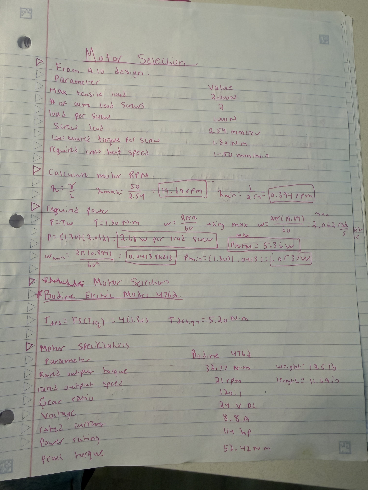
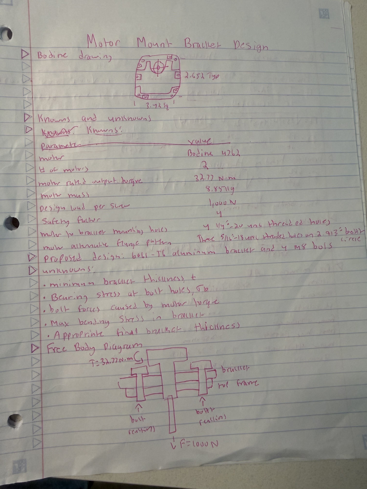
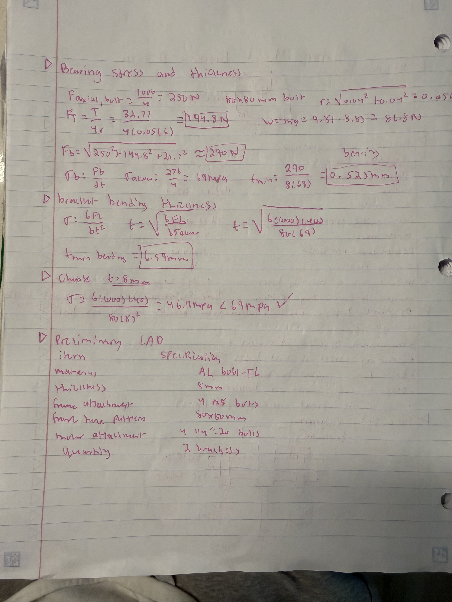

# A11 – Motor Selection

## Objective
The objective of this assignment is to continue the design of a 2 kN tensile testing machine using two Acme lead screws. Building on the preliminary design developed in A10, this phase focuses on selecting suitable motors, designing motor mounting brackets and shaft couplers, evaluating frame connections, and designing floating bearing supports.

Engineering calculations will be performed to verify torque requirements, rotational speed, stresses, component dimensions, and structural safety factors. The design must support a maximum tensile load of 2,000 N, provide a crosshead speed range of 1–50 mm/min, and achieve a target factor of safety of 4.

The final design will incorporate a complete CAD assembly, structural finite element analysis (FEA), and a combined bill of materials and engineering cost analysis for A10 and A11.

## Analyze

<section id="motor-selection">

  <h2>Engineering Analysis</h2>
  <h3>1. Motor Selection and Verification</h3>

  

    Two motors are proposed to drive the Acme lead screws of
    the tensile testing machine. The Bodine Electric Model
    4762 DC gearmotor was selected as the preliminary
    candidate based on its torque capacity, rated speed,
    and availability of manufacturer CAD files.
  

  <h4>Selected Motor Specifications</h4>

  <table border="1" cellpadding="8">
    <tr><th>Parameter</th><th>Value</th></tr>
    <tr><td>Motor</td><td>Bodine Electric 4762</td></tr>
    <tr><td>Rated Torque</td><td>32.77 N&#183;m</td></tr>
    <tr><td>Peak Torque</td><td>52.42 N&#183;m</td></tr>
    <tr><td>Rated Speed</td><td>21 rpm</td></tr>
    <tr><td>Gear Ratio</td><td>120:1</td></tr>
    <tr><td>Voltage</td><td>24 V DC</td></tr>
    <tr><td>Rated Current</td><td>8.8 A</td></tr>
    <tr><td>Motor Power Rating</td><td>0.25 hp</td></tr>
    <tr><td>Quantity</td><td>2</td></tr>
  </table>

  <figure>
    
    <figcaption>
      Figure 1. Selected Bodine Electric 4762 motor.
    </figcaption>
  </figure>

  <figure>
    
    <figcaption>
      Figure 2. Manufacturer motor specifications.
    </figcaption>
  </figure>

  <h4>A. Required Force</h4>

  
Maximum tensile load:

  
Ftotal = 2000 N

  
Number of lead screws = 2

  

    Fscrew = Ftotal / 2
  

  

    Fscrew = 2000 / 2
  

  
<strong>Fscrew = 1000 N</strong>

  <h4>B. Required Rotational Speed</h4>

  
Lead screw travel per revolution:

  
L = 2.54 mm/rev

  
Rotational speed equation:

  
n = v / L

  
<strong>Minimum Speed:</strong>

  
nmin = 1 / 2.54

  
<strong>nmin = 0.394 rpm</strong>

  
<strong>Maximum Speed:</strong>

  
nmax = 50 / 2.54

  
<strong>nmax = 19.69 rpm</strong>

  <h4>C. Required Design Torque</h4>

  

    From A10, the estimated drive torque per lead screw
    was 1.30 N&#183;m.
  

  
Using a conservative torque-sizing factor of 4:

  

    Tdesign =
    FS &times; Trequired
  

  
Tdesign = 4 &times; 1.30

  

    <strong>Tdesign = 5.20 N&#183;m</strong>
  

  <h4>D. Motor Torque Verification</h4>

  
Rated motor output torque = 32.77 N&#183;m

  

    Torque capacity ratio = 32.77 / 1.30
  

  
<strong>Torque capacity ratio = 25.21</strong>

  

    Since 32.77 N&#183;m exceeds the conservative
    5.20 N&#183;m design target, the motor passes
    the preliminary rated-torque capacity check.
  

  <h4>E. Mechanical Power</h4>

  
Angular velocity:

  

    &omega; = (2&pi; &times; n) / 60
  

  

    &omega; = (2&pi; &times; 19.69) / 60
  

  

    <strong>&omega; = 2.062 rad/s</strong>
  

  
Power equation:

  
P = T &times; &omega;

  
P = 1.30 &times; 2.062

  
<strong>P = 2.68 W per lead screw</strong>

  
Total power for two lead screws:

  
Ptotal = 2 &times; 2.68

  
<strong>Ptotal = 5.36 W</strong>

  

    This is the preliminary mechanical power
    requirement, excluding additional drivetrain losses.
  

  <h4>F. Estimated Motor Efficiency</h4>

  
Mechanical output power at rated conditions:

  

    Pout =
    T &times; (2&pi;n / 60)
  

  

    Pout =
    32.77 &times; (2&pi; &times; 21 / 60)
  

  
<strong>Pout = 72.07 W</strong>

  
Electrical input power:

  
Pin = V &times; I

  
Pin = 24 &times; 8.8

  
<strong>Pin = 211.2 W</strong>

  
Estimated overall efficiency:

  

    &eta; =
    (Pout / Pin) &times; 100
  

  

    &eta; = (72.07 / 211.2) &times; 100
  

  
<strong>&eta; = 34.1%</strong>

  

    This is an approximate motor-and-gearbox efficiency
    calculated from the published rated operating values.
  

  <h4>G. Speed-Torque Curve</h4>

  

    The ideal DC motor speed-torque relationship is:
  

  

    &omega; = V/ke -
    (R &times; T)/(kekt)
  

  

    For an illustrative linear model, a no-load
    gearmotor output speed of 25 rpm was assumed.
    Using the manufacturer-rated point of 32.77 N&#183;m
    at 21 rpm:
  

  

    n = 25 - [(25 - 21) / 32.77]T
  

  
<strong>n = 25 - 0.1221T</strong>

  

    The 25 rpm no-load assumption is not verified
    manufacturer data. Therefore, the graph is an
    illustrative engineering estimate, not a validated
    manufacturer speed-torque curve.
  

  

    <strong>
      [INSERT SPEED-TORQUE GRAPH HERE]
    </strong>
  

  <h4>H. Engineering Conclusion</h4>

  

    The Bodine Electric 4762 was retained as the
    preliminary motor selection based on its rated
    torque capacity and maximum rated speed.
    Its rated output torque of 32.77 N&#183;m exceeds
    the conservative design target of 5.20 N&#183;m.
  

  

    Continuous operation across the full required
    speed range of 0.394 to 19.69 rpm has not been
    verified. The minimum operating speed, allowable
    speed-control method, and synchronization of both
    lead screws remain unresolved design items.
  

  

    Manufacturer:
    <a href="https://www.bodine-electric.com/products/dc-right-angle-gearmotors/42a-gb-series-dc-right-angle-gearmotor/4762/">
      Bodine Electric Model 4762
    </a>
  

</section>

<section id="motor-mount-analysis">

  <h3>2. Motor Mount Bracket Design</h3>

  

    Two mounting brackets are required to attach the
    Bodine 4762 gearmotors to the upper frame of the
    tensile testing machine.
  

  

    The brackets must support the motor weight,
    resist applied loads and torque reactions,
    and maintain proper alignment with the
    Acme lead screws.
  

  

    Aluminum 6061-T6 was selected because of its
    strength, machinability, and relatively low weight.
  

  <figure>
    
    <figcaption>
      Figure 5. Preliminary motor mounting bracket
      design concept.
    </figcaption>
  </figure>

  <h4>A. Known Values</h4>

  <table border="1" cellpadding="8">
    <tr><th>Parameter</th><th>Value</th></tr>
    <tr><td>Motor</td><td>Bodine 4762</td></tr>
    <tr><td>Motor Mass</td><td>8.85 kg</td></tr>
    <tr><td>Rated Output Torque</td>
        <td>32.77 N&#183;m</td></tr>
    <tr><td>Assumed Axial Load</td>
        <td>1000 N</td></tr>
    <tr><td>Bracket Material</td>
        <td>6061-T6 Aluminum</td></tr>
    <tr><td>Yield Strength</td>
        <td>276 MPa</td></tr>
    <tr><td>Factor of Safety</td><td>4</td></tr>
    <tr><td>Mounting Bolts</td><td>4 M8</td></tr>
    <tr><td>Proposed Bolt Pattern</td>
        <td>80 x 80 mm</td></tr>
    <tr><td>Unsupported Length</td>
        <td>40 mm</td></tr>
    <tr><td>Effective Bracket Width</td>
        <td>80 mm</td></tr>
  </table>

  

    These dimensions are preliminary assumptions.
    The final bracket must be checked against the
    motor and frame geometry.
  

  <h4>B. Free-Body Diagram</h4>

  <figure>
    
    <figcaption>
      Figure 6. Motor bracket loading and
      support reactions.
    </figcaption>
  </figure>

  <h4>C. Force per Mounting Bolt</h4>

  

    Assuming the axial load is equally
    distributed between four mounting bolts:
  

  

    Faxial = 1000 / 4
  

  

    <strong>Faxial = 250 N</strong>
  

  

    For an 80 x 80 mm square bolt pattern:
  

  

    r = &radic;(402 + 402)
  

  
<strong>r = 56.57 mm = 0.05657 m</strong>

  
Torque-induced tangential force:

  

    FT = T / (4r)
  

  

    FT = 32.77 / (4 x 0.05657)
  

  
<strong>FT = 144.8 N</strong>

  
Motor weight:

  
W = mg

  
W = 8.85 x 9.81

  
<strong>W = 86.8 N</strong>

  
Weight contribution per bolt:

  
FW = 86.8 / 4

  
<strong>FW = 21.7 N</strong>

  

    Illustrative resultant force assuming
    perpendicular loading components:
  

  

    Fb =
    &radic;(2502 +
    144.82 +
    21.72)
  

  
<strong>Fb = 290 N</strong>

  

    This is a simplified bolt-force estimate.
    Actual forces depend on the motor orientation,
    bracket geometry, and bolt preload.
  

  <h4>D. Allowable Stress</h4>

  
Yield strength:

  
&sigma;y = 276 MPa

  

    &sigma;allow =
    &sigma;y / FS
  

  
&sigma;allow = 276 / 4

  

    <strong>
      &sigma;allow = 69 MPa
    </strong>
  

  <h4>E. Minimum Thickness - Bearing Stress</h4>

  
Projected bearing stress:

  
&sigma;b = Fb / (dt)

  
Solving for thickness:

  

    tmin =
    Fb /
    (d &times; &sigma;allow)
  

  

    tmin = 290 / (8 x 69)
  

  

    <strong>tmin = 0.525 mm</strong>
  

  

    This is a simplified projected bearing
    calculation, not a full fastener or
    connection-strength verification.
  

  <h4>F. Minimum Thickness - Bending</h4>

  

    Model the bracket as an equivalent
    rectangular cantilever:
  

  

    &sigma; = 6FL / (bt2)
  

  
Solving for thickness:

  

    t = &radic;[6FL /
    (b &times; &sigma;allow)]
  

  

    F = 1000 N, L = 40 mm, b = 80 mm
  

  

    t = &radic;[(6 x 1000 x 40) / (80 x 69)]
  

  
<strong>tmin = 6.59 mm</strong>

  
Selected preliminary thickness:

  
<strong>t = 8 mm</strong>

  <h4>G. Bending Stress Verification</h4>

  

    &sigma; = 6FL / (bt2)
  

  

    &sigma; = (6 x 1000 x 40) /
    (80 x 82)
  

  
<strong>&sigma; = 46.88 MPa</strong>

  
Comparison:

  
46.88 MPa &lt; 69 MPa

  

    <strong>
      Result: The 8 mm bracket satisfies the
      simplified bending calculation.
    </strong>
  

  <h4>H. Preliminary Design Specifications</h4>

  <table border="1" cellpadding="8">
    <tr><th>Feature</th><th>Specification</th></tr>
    <tr><td>Material</td>
        <td>6061-T6 Aluminum</td></tr>
    <tr><td>Plate Thickness</td><td>8 mm</td></tr>
    <tr><td>Frame Attachment</td>
        <td>Four M8 bolts</td></tr>
    <tr><td>Preliminary Bolt Pattern</td>
        <td>80 x 80 mm</td></tr>
    <tr><td>Motor Attachment</td>
        <td>Manufacturer mounting interface</td></tr>
    <tr><td>Quantity</td><td>2</td></tr>
  </table>

  <h4>I. Engineering Conclusion</h4>

  

    A preliminary 8 mm thick 6061-T6 aluminum
    bracket was selected.
  

  

    The calculated bending stress was 46.88 MPa,
    below the allowable stress of 69 MPa,
    for the assumed cantilever geometry.
  

  

    Final verification must include the actual
    bracket dimensions, motor mounting interface,
    bolt forces, local stresses, and load path
    through the upper frame.
  

</section>

### 3. Coupler Design and Torsion Analysis

Two shaft couplers are required to connect the Bodine 4762 gearmotors to the Acme lead screws. Each coupler must transmit motor torque while maintaining shaft alignment and preventing excessive torsional stress.

6061-T6 aluminum was selected as the preliminary coupler material because of its strength, machinability, and relatively low weight.

**[INSERT PICTURE 9 — Coupler Design Concept]**

*Figure 9. Preliminary shaft coupler connecting the motor output shaft to the Acme lead screw.*

#### A. Known Values

| Parameter | Value |
|---|---|
| Motor | Bodine 4762 |
| Rated motor torque | 32.77 N·m |
| Peak motor torque | 52.42 N·m |
| Motor output shaft | 19.05 mm nominal |
| Acme screw diameter | 12.70 mm nominal |
| Coupler material | 6061-T6 aluminum |
| Yield strength | 276 MPa |
| Factor of safety | 4 |
| Number of couplers | 2 |

The coupler must accommodate two different shaft diameters. The Acme screw end will require a suitable machined journal or adapter.

#### B. Free-Body Diagram

The coupler transmits torque from the motor to the lead screw.

**[INSERT PICTURE 10 — Coupler Torsion FBD]**

*Figure 10. Free-body diagram showing motor input torque, resisting torque, and the coupler's torsional loading.*

From rotational equilibrium:

\[
\sum M_x=0
\]

\[
T_{\text{motor}}-T_{\text{screw}}=0
\]

#### C. Design Torque

For a conservative preliminary analysis, apply a factor of safety of 4 to the rated motor torque:

\[
T_d=FS(T_{\text{rated}})
\]

\[
T_d=4(32.77)
\]

\[
\boxed{T_d=131.08\text{ N}\cdot\text{m}}
\]

Converting:

\[
\boxed{T_d=131080\text{ N}\cdot\text{mm}}
\]

This design torque exceeds the manufacturer's published peak motor torque and provides a conservative initial sizing load.

#### D. Allowable Shear Stress

Using the von Mises shear-yield approximation:

\[
\tau_y=\frac{\sigma_y}{\sqrt{3}}
\]

\[
\tau_y=\frac{276}{\sqrt{3}}
\]

\[
\boxed{\tau_y=159.35\text{ MPa}}
\]

The factor of safety has already been applied to the design torque, so the same factor is not applied again to the allowable stress.

#### E. Minimum Coupler Outside Diameter

For a hollow circular shaft:

\[
\tau_{\max}=\frac{Tc}{J}
\]

Where:

\[
c=\frac{D_o}{2}
\]

\[
J=\frac{\pi}{32}(D_o^4-D_i^4)
\]

Substituting:

\[
\boxed{\tau_{\max}=\frac{16TD_o}{\pi(D_o^4-D_i^4)}}
\]

Using:

\[
D_i=19.05\text{ mm}
\]

\[
T=131080\text{ N}\cdot\text{mm}
\]

The minimum diameter is determined from:

\[
159.35=\frac{16(131080)D_o}{\pi(D_o^4-19.05^4)}
\]

Solving numerically:

\[
\boxed{D_{o,\min}\approx21.9\text{ mm}}
\]

This calculation applies to an ideal, unkeyed hollow circular section.

#### F. Select Coupler Diameter

A preliminary outside diameter of 35 mm was selected to provide additional material for the keyed connection and machining.

\[
\boxed{D_o=35\text{ mm}}
\]

Check maximum shear stress:

\[
\tau_{\max}=\frac{16(131080)(35)}{\pi(35^4-19.05^4)}
\]

\[
\boxed{\tau_{\max}\approx17.07\text{ MPa}}
\]

Since:

\[
17.07<159.35\text{ MPa}
\]

The selected diameter passes the simplified torsional shear calculation.

#### G. Coupler Wall Thickness

The minimum wall thickness occurs around the larger motor-side bore.

\[
t=\frac{D_o-D_i}{2}
\]

\[
t=\frac{35-19.05}{2}
\]

\[
\boxed{t=7.98\text{ mm}}
\]

#### H. Preliminary Coupler Specifications

| Feature | Selection |
|---|---|
| Material | 6061-T6 aluminum |
| Outer diameter | 35 mm |
| Motor-side bore | 19.05 mm nominal |
| Lead screw-side bore | 12.70 mm nominal, subject to journal design |
| Motor-side radial wall thickness | 7.98 mm |
| Motor connection | Keyed interface |
| Coupler quantity | 2 |
| Overall length | To be confirmed from shaft engagement requirements |

The selected dimensions provide a preliminary coupler envelope. Final CAD must establish shaft engagement lengths, bore tolerances, keyway dimensions, and a suitable lead screw-end connection.

[INSERT PICTURE 11 — Dimensioned Coupler CAD]

Figure 11. CAD model showing the coupler's stepped bores, outside diameter, keyway, and overall length.

[INSERT PICTURE 12 — Motor, Coupler, and Lead Screw Assembly]

Figure 12. Coupler installed between the Bodine 4762 output shaft and the Acme lead screw.

I. Engineering Conclusion

A preliminary coupler outside diameter of 35 mm was selected. The simplified torsional analysis produced a maximum shear stress of approximately 17.07 MPa under the conservative design torque of 131.08 N·m.

The selected diameter satisfies the ideal hollow-shaft torsion calculation. Final verification must account for keyway stresses, shaft connections, machining tolerances, alignment, and any coupling flexibility required by the assembly.

The preliminary geometry will be incorporated into the CAD model and evaluated for fit with the motor and lead screw.
### 4. Frame Connection Analysis

The tensile testing machine uses a Heavy 40 Series aluminum extrusion frame to support the two Acme lead screws, moving crosshead, and motor assemblies.

During operation, motor reaction torques and tensile forces are transferred into the upper frame through the motor mounts and lead screw supports. The frame connections must resist these loads without excessive movement or failure.

A preliminary analysis was performed to determine the applied twisting moment, support reactions, and suitable T-slot connectors.

**[INSERT PICTURE 13 — Top Frame Connection Concept]**

*Figure 13. Upper aluminum frame showing the two motor locations and connections to the vertical supports.*

#### A. Known Values

| Parameter | Value |
|---|---|
| Maximum tensile load | 2,000 N |
| Number of motors | 2 |
| Load per lead screw | 1,000 N |
| Motor | Bodine Electric 4762 |
| Rated motor torque | 32.77 N·m |
| Lead screw spacing | 200 mm |
| Frame material | Heavy 40 Series aluminum |
| Required factor of safety | 4 |

The actual frame support spacing and connector locations will be established from the final CAD geometry.

#### B. Free-Body Diagram

The upper frame is subjected to motor reaction torques, lead screw support forces, and reactions from the vertical frame connections.

**[INSERT PICTURE 14 — Frame Connection FBD]**

*Figure 14. Free-body diagram of the upper frame showing two motor reaction torques, vertical screw-support loads, and frame connection reactions.*

#### C. Calculate Motor-Induced Twisting Moment

Assuming the two motor reaction torques act in the same direction:

\[
M_{\text{total}}=T_1+T_2
\]

\[
M_{\text{total}}=32.77+32.77
\]

\[
\boxed{M_{\text{total}}=65.54\text{ N}\cdot\text{m}}
\]

This is a conservative combined rated-torque loading case.

Under the nominal operating condition:

\[
M_{\text{nominal}}=2(1.30)
\]

\[
\boxed{M_{\text{nominal}}=2.60\text{ N}\cdot\text{m}}
\]

Both loading cases are considered in the preliminary design.

Actual net frame torque depends on the motor rotation directions and mounting orientation.

#### D. Frame Connection Reactions

For a simplified equivalent force couple resisting the twisting moment:

\[
\sum M=0
\]

\[
R(S)=M_{\text{total}}
\]

Rearranging:

\[
\boxed{R=\frac{M_{\text{total}}}{S}}
\]

Where:

- \(R\) = equivalent reaction force (N)
- \(S\) = separation between the opposing reaction force lines (m)
- \(M_{\text{total}}\) = applied twisting moment (N·m)

For an illustrative reaction separation of 200 mm:

\[
S=0.200\text{ m}
\]

\[
R=\frac{65.54}{0.200}
\]

\[
\boxed{R=327.7\text{ N}}
\]

The 200 mm distance comes from the lead screw spacing and is used here only as an illustrative moment arm. It is not yet the verified frame connection spacing.

Final reactions must be recalculated using the actual connection geometry.

#### E. T-Slot Connector Selection

The preliminary connector selected is:

**80/20 Part 40-4303 — Four-Hole Wide Inside Corner Bracket**

This bracket is designed for right-angle connections in compatible 40 Series aluminum extrusion assemblies.

Manufacturer reference:

https://airinc.net/wp-content/uploads/2021/04/40-4303-Tech-Sheet.pdf

Proposed connection arrangement:

| Feature | Preliminary selection |
|---|---|
| Frame | Heavy 40 Series aluminum extrusion |
| Connector | 80/20 Part 40-4303 |
| Connection type | Right-angle corner bracket |
| Preliminary quantity | 4 brackets |
| Fasteners | Compatible T-slot bolts and T-nuts |
| Factor of safety target | 4 |

The proposed arrangement places reinforced connections at the upper horizontal frame member and vertical supports.

**[INSERT PICTURE 15 — T-Slot Connector]**

*Figure 15. Selected 80/20 40-4303 four-hole corner bracket with manufacturer dimensions.*

#### F. Connection Stress Verification

For a symmetric four-fastener bolt group resisting a moment:

\[
F_i=\frac{Mr_i}{\sum r_j^2}
\]

If all four fasteners are the same distance \(r\) from the bolt-group centroid:

\[
\boxed{F_i=\frac{M}{4r}}
\]

The actual force calculation requires the finalized connector geometry, fastener positions, and load distribution.

Connection safety factor:

\[
FS=\frac{\text{Allowable connection capacity}}{\text{Applied connection load}}
\]

The design target is:

\[
\boxed{FS\geq4}
\]

The final analysis must account for fastener shear, tension, bracket bending, T-slot retention, and the manufacturer's allowable connection loads. A numerical safety factor cannot be established from the preliminary geometry alone.

#### G. CAD and FEA Verification

The CAD assembly will establish the final frame connection locations and the arrangement of the T-slot brackets.

**[INSERT PICTURE 16 — Completed Frame Connection CAD]**

*Figure 16. Final CAD close-up showing the selected corner brackets, fasteners, and connections between the upper horizontal frame and vertical supports.*

FEA will be used to evaluate stresses and deflections in the horizontal and vertical frame members. The connection load cases must be consistent with the actual motor and lead screw load paths.

#### H. Engineering Conclusion

The preliminary analysis produced a combined rated motor reaction torque of 65.54 N·m and a nominal operating torque of 2.60 N·m.

The 80/20 40-4303 corner bracket was selected as a preliminary connection component because of its compatibility with 40 Series T-slot framing.

Final connection geometry, fastener loading, allowable capacities, and structural safety factors must be verified using the completed CAD assembly and manufacturer specifications.

### 7. Floating Bearing Mount Analysis

The tensile testing machine requires two floating bearing supports at the bottom of the Acme lead screws. These supports allow the screws to rotate while providing radial support and accommodating small axial movements.

The upper fixed bearings are intended to resist the lead screw's axial thrust, while the lower floating bearings prevent excessive lateral movement and avoid overconstraining the screws.

**[INSERT PICTURE 17 — Fixed and Floating Bearing Arrangement Diagram]**

*Figure 17. Engineering diagram illustrating the fixed upper bearing and floating lower bearing arrangement.*

#### A. Known Values

| Parameter | Value |
|---|---|
| Number of lead screws | 2 |
| Lead screw type | 1/2"-10 Acme |
| Nominal screw diameter | 12.70 mm |
| Minimum screw length | 457.2 mm |
| Lead screw center spacing | 200 mm |
| Bearing mount material | 6061-T6 aluminum |
| Required fit | RC3 precision running fit |
| Required factor of safety | 4 |

#### B. Preliminary Design Dimensions

| Feature | Preliminary dimension |
|---|---|
| Mount width | 80 mm |
| Mount height | 40 mm |
| Mount thickness | 20 mm |
| Proposed machined journal diameter | 12 mm |
| Mounting fasteners | Two M8 bolts |
| Nominal bolt clearance holes | 9 mm |
| Number of mounts | 2 |

The dimensions above are preliminary design selections and must be checked against the actual lower frame geometry.

#### C. Free-Body Diagram

The floating support is designed to resist radial reactions while allowing axial movement of the lead screw.

**[INSERT PICTURE 18 — Floating Bearing Free-Body Diagram]**

*Figure 18. Free-body diagram showing radial bearing reactions and the intended axial freedom at the lower lead screw support.*

For radial equilibrium:

\[
\sum F_x=0,\qquad \sum F_y=0
\]

For the ideal floating support:

\[
R_{\text{axial}}=0
\]

The axial load is intended to be carried by the upper fixed bearing arrangement.

#### D. Bearing Pressure Analysis

Projected bearing pressure is calculated using:

\[
p=\frac{R}{dL_b}
\]

Where:

- \(R\) = radial bearing reaction (N)
- \(d\) = journal diameter (mm)
- \(L_b\) = effective bearing length (mm)

Using the proposed 12 mm journal diameter and 20 mm bearing length:

\[
p=\frac{R}{12(20)}
\]

\[
\boxed{p=\frac{R}{240}\text{ MPa}}
\]

A numerical bearing pressure cannot be determined until the radial reaction and selected bearing arrangement are established.

The 1,000 N axial load per lead screw is not automatically equivalent to the radial bearing reaction.

#### E. RC3 Running Fit

An RC3 precision running fit was specified for the rotating bearing interface.

The purpose of the fit is to provide controlled clearance for smooth rotation while maintaining accurate shaft alignment.

Proposed nominal journal diameter:

\[
\boxed{d=12.00\text{ mm}}
\]

The final upper and lower tolerance limits must be selected from an applicable ANSI B4.1 RC3 fit table for the corresponding basic size.

The fit must be applied to the correct rotating shaft and mating bearing surface. If a rolling-element bearing is selected, its manufacturer-specified shaft and housing fits must also be respected.

**[INSERT PICTURE 19 — RC3 Fit and Tolerance Diagram]**

*Figure 19. Shaft and mating bore tolerance zones illustrating the required precision running fit.*

#### F. Mounting Bolt Clearance

Two M8 bolts were provisionally selected to attach each support to the lower frame.

Using a normal clearance hole:

\[
\boxed{d_h=9.0\text{ mm}}
\]

The mounting-hole locations and bolt loads will be finalized using the actual lower frame connections.

#### G. Engineering Conclusion

A preliminary 6061-T6 aluminum floating bearing mount measuring 80 × 40 × 20 mm was selected for each lead screw.

A 12 mm machined journal and RC3 running fit are proposed to provide controlled rotational clearance.

The bearing-pressure equation and mounting requirements have been established. Final validation requires the actual radial reactions, selected bearing dimensions, numerical RC3 tolerance limits, and verification of the fixed–floating support arrangement.

## Cost Analysis and Bill of Materials

### 8. Combined A10 and A11 Cost Analysis

A preliminary cost analysis was performed to estimate the total cost of designing and constructing the 2 kN tensile testing machine. The analysis includes components selected during A10 and A11, purchased materials, custom-manufactured components, and engineering labor.

Supplier prices were used where available. Components without confirmed prices are identified separately and will be updated after final CAD verification.

#### A. Purchased Components

| Component | Quantity | Unit Cost | Total |
|---|---:|---:|---:|
| Bodine 4762 DC gearmotor | 2 | $1,145.44 | $2,290.88 |
| Roton #59284 Acme lead screw | 3 ft | $9.10/ft | $27.30 |
| Roton #90222 bronze nut | 2 | $23.57 | $47.14 |
| 80/20 40-4303 corner bracket | 4 | $8.79 | $35.16 |
| Roton #89838 mounting flange | 2 | TBD | TBD |
| Bearings and bearing hardware | TBD | TBD | TBD |
| Motor/frame fasteners | TBD | TBD | TBD |

**Subtotal of priced purchased components:**

\[
C_{\text{purchased}}=2290.88+27.30+47.14+35.16
\]

\[
\boxed{C_{\text{purchased}}=\$2400.48}
\]

**[INSERT PICTURE 20 — Selected Purchased Components and Supplier Prices]**

*Figure 20. Manufacturer and supplier references for the selected motors, lead screws, nuts, and frame connectors.*

#### B. Aluminum Frame Cost

The preliminary frame design uses Heavy 40 Series aluminum T-slot extrusion.

Estimated extrusion length:

\[
L=2160\text{ mm}
\]

Estimated price:

\[
C_{\text{unit}}=\$0.0821/\text{mm}
\]

Material cost:

\[
C_{\text{material}}=(2160)(0.0821)
\]

\[
\boxed{C_{\text{material}}=\$177.34}
\]

Assuming four cuts at $3.79 per cut:

\[
C_{\text{cutting}}=4(3.79)=\$15.16
\]

Total preliminary frame cost:

\[
C_{\text{frame}}=177.34+15.16
\]

\[
\boxed{C_{\text{frame}}=\$192.50}
\]

The extrusion length and number of cuts are preliminary estimates and must be updated using the final CAD cut list.

#### C. Custom Manufactured Components

The following components require fabrication or additional sourcing.

| Component | Quantity | Material | Cost |
|---|---:|---|---|
| Moving crosshead | 1 | 6061-T6 aluminum | TBD |
| Motor mounting brackets | 2 | 6061-T6 aluminum | TBD |
| Shaft couplers | 2 | 6061-T6 aluminum | TBD |
| Floating bearing mounts | 2 | 6061-T6 aluminum | TBD |
| Fixed bearing supports | 2 | To be selected | TBD |
| Specimen grips/adapters | 2 sets | To be selected | TBD |

These components will be priced using the final material dimensions, stock requirements, and estimated fabrication costs.

**[INSERT PICTURE 21 — Custom Component Material and Cost References]**

*Figure 21. Material selections and supplier references for the custom components.*

#### D. Engineering Labor Cost

The required engineering labor rate is:

\[
R=\$35/\text{hour}
\]

Labor cost is calculated using:

\[
C_{\text{labor}}=R(H_{\text{total}})
\]

Where \(H_{\text{total}}\) represents the team's actual engineering hours for A10 and A11.

For an illustrative estimate of 20 total engineering hours:

\[
C_{\text{labor}}=35(20)
\]

\[
\boxed{C_{\text{labor}}=\$700.00}
\]

The 20-hour value is an example and will be replaced with actual recorded hours before final submission.

#### E. Preliminary Total Cost

Purchased components:

\[
C_{\text{purchased}}=\$2400.48
\]

Aluminum frame:

\[
C_{\text{frame}}=\$192.50
\]

Illustrative engineering labor:

\[
C_{\text{labor}}=\$700.00
\]

Combined partial estimate:

\[
C_{\text{partial}}=2400.48+192.50+700.00
\]

\[
\boxed{C_{\text{partial}}=\$3292.98}
\]

This is a partial cost estimate, not the final machine cost. It excludes unpriced components, custom fabrication costs, shipping, taxes, and other required hardware.

The complete cost will be calculated using:

\[
\boxed{C_{\text{total}}=C_{\text{materials}}+C_{\text{purchased}}+C_{\text{fabrication}}+C_{\text{labor}}}
\]

**[INSERT PICTURE 22 — Final BOM and Cost Summary]**

*Figure 22. Updated bill of materials showing confirmed component quantities, supplier prices, fabrication costs, and total engineering labor.*

#### F. Engineering Conclusion

The preliminary combined A10 and A11 cost analysis produced a partial estimate of $3,292.98, including an illustrative 20-hour engineering labor allowance.

The two Bodine 4762 gearmotors represent the largest identified purchased-component expense. Material costs were estimated using supplier pricing, while custom components and additional hardware remain subject to final design confirmation.

The bill of materials will be updated after the CAD assembly is completed and actual engineering labor hours are recorded.

## Decide
_Reference your concept selection (Pugh matrix) here. How does this design follow from that decision?_

## Communicate
