# A11 – Motor Selection

## Objective
The objective of this assignment is to continue the design of a 2 kN tensile testing machine using two Acme lead screws. Building on the preliminary design developed in A10, this phase focuses on selecting suitable motors, designing motor mounting brackets and shaft couplers, evaluating frame connections, and designing floating bearing supports.

Engineering calculations will be performed to verify torque requirements, rotational speed, stresses, component dimensions, and structural safety factors. The design must support a maximum tensile load of 2,000 N, provide a crosshead speed range of 1–50 mm/min, and achieve a target factor of safety of 4.

The final design will incorporate a complete CAD assembly, structural finite element analysis (FEA), and a combined bill of materials and engineering cost analysis for A10 and A11.

## Analyze

<section id="motor-selection">

  <h2>Engineering Analysis</h2>
  <h3>1. Motor Selection and Verification</h3>

  

    Two motors are proposed to drive the Acme lead screws of
    the tensile testing machine. The Bodine Electric Model
    4762 DC gearmotor was selected as the preliminary
    candidate based on its torque capacity, rated speed,
    and availability of manufacturer CAD files.
  

  <h4>Selected Motor Specifications</h4>

  <table border="1" cellpadding="8">
    <tr><th>Parameter</th><th>Value</th></tr>
    <tr><td>Motor</td><td>Bodine Electric 4762</td></tr>
    <tr><td>Rated Torque</td><td>32.77 N&#183;m</td></tr>
    <tr><td>Peak Torque</td><td>52.42 N&#183;m</td></tr>
    <tr><td>Rated Speed</td><td>21 rpm</td></tr>
    <tr><td>Gear Ratio</td><td>120:1</td></tr>
    <tr><td>Voltage</td><td>24 V DC</td></tr>
    <tr><td>Rated Current</td><td>8.8 A</td></tr>
    <tr><td>Motor Power Rating</td><td>0.25 hp</td></tr>
    <tr><td>Quantity</td><td>2</td></tr>
  </table>

  <figure>
    
  </figure>

  <figure>
    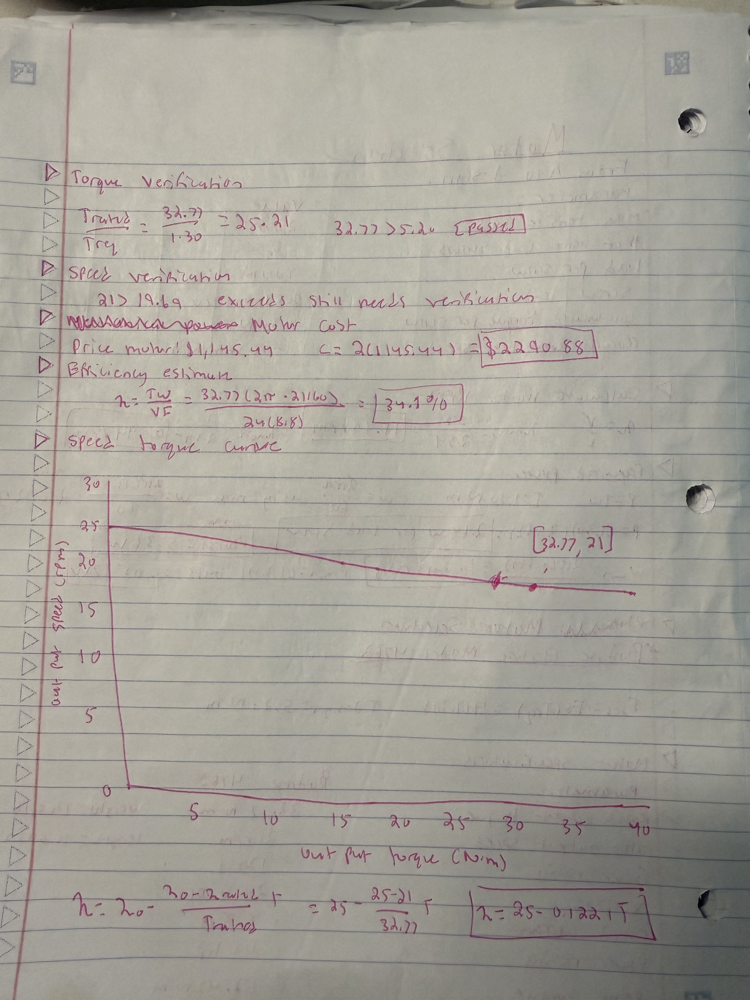
  </figure>

  <h4>A. Required Force</h4>

  
Maximum tensile load:

  
Ftotal = 2000 N

  
Number of lead screws = 2

  

    Fscrew = Ftotal / 2
  

  

    Fscrew = 2000 / 2
  

  
<strong>Fscrew = 1000 N</strong>

  <h4>B. Required Rotational Speed</h4>

  
Lead screw travel per revolution:

  
L = 2.54 mm/rev

  
Rotational speed equation:

  
n = v / L

  
<strong>Minimum Speed:</strong>

  
nmin = 1 / 2.54

  
<strong>nmin = 0.394 rpm</strong>

  
<strong>Maximum Speed:</strong>

  
nmax = 50 / 2.54

  
<strong>nmax = 19.69 rpm</strong>

  <h4>C. Required Design Torque</h4>

  

    From A10, the estimated drive torque per lead screw
    was 1.30 N&#183;m.
  

  
Using a conservative torque-sizing factor of 4:

  

    Tdesign =
    FS &times; Trequired
  

  
Tdesign = 4 &times; 1.30

  

    <strong>Tdesign = 5.20 N&#183;m</strong>
  

  <h4>D. Motor Torque Verification</h4>

  
Rated motor output torque = 32.77 N&#183;m

  

    Torque capacity ratio = 32.77 / 1.30
  

  
<strong>Torque capacity ratio = 25.21</strong>

  

    Since 32.77 N&#183;m exceeds the conservative
    5.20 N&#183;m design target, the motor passes
    the preliminary rated-torque capacity check.
  

  <h4>E. Mechanical Power</h4>

  
Angular velocity:

  

    &omega; = (2&pi; &times; n) / 60
  

  

    &omega; = (2&pi; &times; 19.69) / 60
  

  

    <strong>&omega; = 2.062 rad/s</strong>
  

  
Power equation:

  
P = T &times; &omega;

  
P = 1.30 &times; 2.062

  
<strong>P = 2.68 W per lead screw</strong>

  
Total power for two lead screws:

  
Ptotal = 2 &times; 2.68

  
<strong>Ptotal = 5.36 W</strong>

  

    This is the preliminary mechanical power
    requirement, excluding additional drivetrain losses.
  

  <h4>F. Estimated Motor Efficiency</h4>

  
Mechanical output power at rated conditions:

  

    Pout =
    T &times; (2&pi;n / 60)
  

  

    Pout =
    32.77 &times; (2&pi; &times; 21 / 60)
  

  
<strong>Pout = 72.07 W</strong>

  
Electrical input power:

  
Pin = V &times; I

  
Pin = 24 &times; 8.8

  
<strong>Pin = 211.2 W</strong>

  
Estimated overall efficiency:

  

    &eta; =
    (Pout / Pin) &times; 100
  

  

    &eta; = (72.07 / 211.2) &times; 100
  

  
<strong>&eta; = 34.1%</strong>

  

    This is an approximate motor-and-gearbox efficiency
    calculated from the published rated operating values.
  

  <h4>G. Speed-Torque Curve</h4>

  

    The ideal DC motor speed-torque relationship is:
  

  

    &omega; = V/ke -
    (R &times; T)/(kekt)
  

  

    For an illustrative linear model, a no-load
    gearmotor output speed of 25 rpm was assumed.
    Using the manufacturer-rated point of 32.77 N&#183;m
    at 21 rpm:
  

  

    n = 25 - [(25 - 21) / 32.77]T
  

  
<strong>n = 25 - 0.1221T</strong>

  

    The 25 rpm no-load assumption is not verified
    manufacturer data. Therefore, the graph is an
    illustrative engineering estimate, not a validated
    manufacturer speed-torque curve.
  

  <h4>H. Engineering Conclusion</h4>

  

    The Bodine Electric 4762 was retained as the
    preliminary motor selection based on its rated
    torque capacity and maximum rated speed.
    Its rated output torque of 32.77 N&#183;m exceeds
    the conservative design target of 5.20 N&#183;m.
  

  

    Continuous operation across the full required
    speed range of 0.394 to 19.69 rpm has not been
    verified. The minimum operating speed, allowable
    speed-control method, and synchronization of both
    lead screws remain unresolved design items.
  

  

    Manufacturer:
    <a href="https://www.bodine-electric.com/products/dc-right-angle-gearmotors/42a-gb-series-dc-right-angle-gearmotor/4762/">
      Bodine Electric Model 4762
    </a>
  

</section>

<section id="motor-mount-analysis">

  <h3>2. Motor Mount Bracket Design</h3>

  

    Two mounting brackets are required to attach the
    Bodine 4762 gearmotors to the upper frame of the
    tensile testing machine.
  

  

    The brackets must support the motor weight,
    resist applied loads and torque reactions,
    and maintain proper alignment with the
    Acme lead screws.
  

  

    Aluminum 6061-T6 was selected because of its
    strength, machinability, and relatively low weight.
  

  <figure>
    
  </figure>

  <h4>A. Known Values</h4>

  <table border="1" cellpadding="8">
    <tr><th>Parameter</th><th>Value</th></tr>
    <tr><td>Motor</td><td>Bodine 4762</td></tr>
    <tr><td>Motor Mass</td><td>8.85 kg</td></tr>
    <tr><td>Rated Output Torque</td>
        <td>32.77 N&#183;m</td></tr>
    <tr><td>Assumed Axial Load</td>
        <td>1000 N</td></tr>
    <tr><td>Bracket Material</td>
        <td>6061-T6 Aluminum</td></tr>
    <tr><td>Yield Strength</td>
        <td>276 MPa</td></tr>
    <tr><td>Factor of Safety</td><td>4</td></tr>
    <tr><td>Mounting Bolts</td><td>4 M8</td></tr>
    <tr><td>Proposed Bolt Pattern</td>
        <td>80 x 80 mm</td></tr>
    <tr><td>Unsupported Length</td>
        <td>40 mm</td></tr>
    <tr><td>Effective Bracket Width</td>
        <td>80 mm</td></tr>
  </table>

  

    These dimensions are preliminary assumptions.
    The final bracket must be checked against the
    motor and frame geometry.
  

  <h4>B. Free-Body Diagram</h4>

  <figure>
    
  </figure>

  <h4>C. Force per Mounting Bolt</h4>

  

    Assuming the axial load is equally
    distributed between four mounting bolts:
  

  

    Faxial = 1000 / 4
  

  

    <strong>Faxial = 250 N</strong>
  

  

    For an 80 x 80 mm square bolt pattern:
  

  

    r = &radic;(402 + 402)
  

  
<strong>r = 56.57 mm = 0.05657 m</strong>

  
Torque-induced tangential force:

  

    FT = T / (4r)
  

  

    FT = 32.77 / (4 x 0.05657)
  

  
<strong>FT = 144.8 N</strong>

  
Motor weight:

  
W = mg

  
W = 8.85 x 9.81

  
<strong>W = 86.8 N</strong>

  
Weight contribution per bolt:

  
FW = 86.8 / 4

  
<strong>FW = 21.7 N</strong>

  

    Illustrative resultant force assuming
    perpendicular loading components:
  

  

    Fb =
    &radic;(2502 +
    144.82 +
    21.72)
  

  
<strong>Fb = 290 N</strong>

  

    This is a simplified bolt-force estimate.
    Actual forces depend on the motor orientation,
    bracket geometry, and bolt preload.
  

  <h4>D. Allowable Stress</h4>

  
Yield strength:

  
&sigma;y = 276 MPa

  

    &sigma;allow =
    &sigma;y / FS
  

  
&sigma;allow = 276 / 4

  

    <strong>
      &sigma;allow = 69 MPa
    </strong>
  

  <h4>E. Minimum Thickness - Bearing Stress</h4>

  
Projected bearing stress:

  
&sigma;b = Fb / (dt)

  
Solving for thickness:

  

    tmin =
    Fb /
    (d &times; &sigma;allow)
  

  

    tmin = 290 / (8 x 69)
  

  

    <strong>tmin = 0.525 mm</strong>
  

  

    This is a simplified projected bearing
    calculation, not a full fastener or
    connection-strength verification.
  

  <h4>F. Minimum Thickness - Bending</h4>

  

    Model the bracket as an equivalent
    rectangular cantilever:
  

  

    &sigma; = 6FL / (bt2)
  

  
Solving for thickness:

  

    t = &radic;[6FL /
    (b &times; &sigma;allow)]
  

  

    F = 1000 N, L = 40 mm, b = 80 mm
  

  

    t = &radic;[(6 x 1000 x 40) / (80 x 69)]
  

  
<strong>tmin = 6.59 mm</strong>

  
Selected preliminary thickness:

  
<strong>t = 8 mm</strong>

  <h4>G. Bending Stress Verification</h4>

  

    &sigma; = 6FL / (bt2)
  

  

    &sigma; = (6 x 1000 x 40) /
    (80 x 82)
  

  
<strong>&sigma; = 46.88 MPa</strong>

  
Comparison:

  
46.88 MPa &lt; 69 MPa

  

    <strong>
      Result: The 8 mm bracket satisfies the
      simplified bending calculation.
    </strong>
  

  <h4>H. Preliminary Design Specifications</h4>

  <table border="1" cellpadding="8">
    <tr><th>Feature</th><th>Specification</th></tr>
    <tr><td>Material</td>
        <td>6061-T6 Aluminum</td></tr>
    <tr><td>Plate Thickness</td><td>8 mm</td></tr>
    <tr><td>Frame Attachment</td>
        <td>Four M8 bolts</td></tr>
    <tr><td>Preliminary Bolt Pattern</td>
        <td>80 x 80 mm</td></tr>
    <tr><td>Motor Attachment</td>
        <td>Manufacturer mounting interface</td></tr>
    <tr><td>Quantity</td><td>2</td></tr>
  </table>

  <h4>I. Engineering Conclusion</h4>

  

    A preliminary 8 mm thick 6061-T6 aluminum
    bracket was selected.
  

  

    The calculated bending stress was 46.88 MPa,
    below the allowable stress of 69 MPa,
    for the assumed cantilever geometry.
  

  

    Final verification must include the actual
    bracket dimensions, motor mounting interface,
    bolt forces, local stresses, and load path
    through the upper frame.
  

</section>

<section id="coupler-analysis">

  <h3>3. Coupler Design and Torsional Analysis</h3>

  

    Two couplers are required to connect the Bodine 4762
    gearmotor output shafts to the Acme lead screws.
    Each coupler must transmit rotational torque while
    maintaining proper shaft alignment.
  

  

    A preliminary aluminum coupler was evaluated using
    torsional shear stress calculations. The final
    connection geometry must match the motor output
    shaft and the machined lead screw ends.
  

  <figure>
    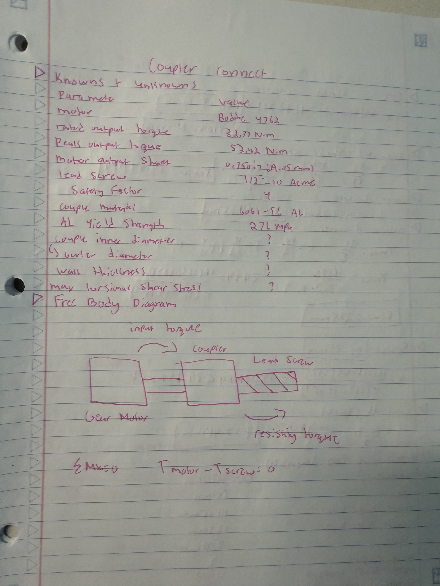
  </figure>

  <h4>A. Known Values</h4>

  <table border="1" cellpadding="8">
    <tr><th>Parameter</th><th>Value</th></tr>
    <tr><td>Motor Output Shaft Diameter</td>
        <td>19.05 mm (0.75 in)</td></tr>
    <tr><td>Acme Lead Screw Nominal Diameter</td>
        <td>12.7 mm (0.50 in)</td></tr>
    <tr><td>Motor Rated Torque</td>
        <td>32.77 N&#183;m</td></tr>
    <tr><td>Factor of Safety</td><td>4</td></tr>
    <tr><td>Material</td><td>6061-T6 Aluminum</td></tr>
    <tr><td>Yield Strength</td><td>276 MPa</td></tr>
    <tr><td>Selected Outside Diameter</td>
        <td>35 mm</td></tr>
    <tr><td>Quantity</td><td>2</td></tr>
  </table>

  <h4>B. Coupler Design Torque</h4>

  

    The coupler was conservatively sized using four
    times the rated output torque of the motor.
  

  

    Tdesign =
    FS &times; Trated
  

  

    Tdesign = 4 &times; 32.77
  

  

    <strong>
      Tdesign = 131.08 N&#183;m
    </strong>
  

  

    Converting to N&#183;mm:
  

  

    Tdesign = 131,080 N&#183;mm
  

  <h4>C. Allowable Shear Stress</h4>

  

    For a ductile material, the von Mises estimate
    of shear yield strength is:
  

  

    &tau;yield =
    &sigma;y / &radic;3
  

  

    &tau;yield = 276 / &radic;3
  

  

    <strong>
      &tau;yield = 159.35 MPa
    </strong>
  

  

    Because the design torque already includes a
    factor of safety of 4, the design stress is
    compared with the estimated shear yield
    strength without applying that factor again.
  

  <h4>D. Coupler Torsion Equation</h4>

  

    For a uniform hollow circular shaft:
  

  

    &tau;max = Tc / J
  

  

    J = &pi;(Do4 -
    Di4) / 32
  

  

    c = Do / 2
  

  

    Substituting:
  

  

    &tau;max =
    16TDo /
    [&pi;(Do4 -
    Di4)]
  

  

    The maximum bore diameter was taken as
    19.05 mm to represent the motor shaft end.
  

  <h4>E. Preliminary Coupler Diameter</h4>

  

    Using:
  

  

    T = 131,080 N&#183;mm
  

  

    Di = 19.05 mm
  

  

    &tau;yield = 159.35 MPa
  

  

    Solve:
  

  

    159.35 =
    (16 &times; 131,080 &times; Do) /
    [&pi;(Do4 -
    19.054)]
  

  

    <strong>
      Minimum outside diameter is approximately
      21.9 mm.
    </strong>
  

  

    A larger preliminary diameter was selected:
  

  

    <strong>Do = 35 mm</strong>
  

  <h4>F. Coupler Wall Thickness</h4>

  

    Minimum wall thickness at the larger bore:
  

  

    t = (Do - Di) / 2
  

  

    t = (35 - 19.05) / 2
  

  

    <strong>t = 7.975 mm</strong>
  

  <h4>G. Torsional Stress Verification</h4>

  

    Substitute the selected dimensions into the
    hollow-shaft torsion equation:
  

  

    &tau;max =
    (16 &times; 131,080 &times; 35) /
    [&pi;(354 - 19.054)]
  

  

    <strong>
      &tau;max &asymp; 17.07 MPa
    </strong>
  

  

    Since:
  

  

    17.07 MPa &lt; 159.35 MPa
  

  

    The selected 35 mm outside diameter passes
    this preliminary idealized torsional
    stress check.
  

  <h4>H. Coupler Load Diagram</h4>

  <figure>
    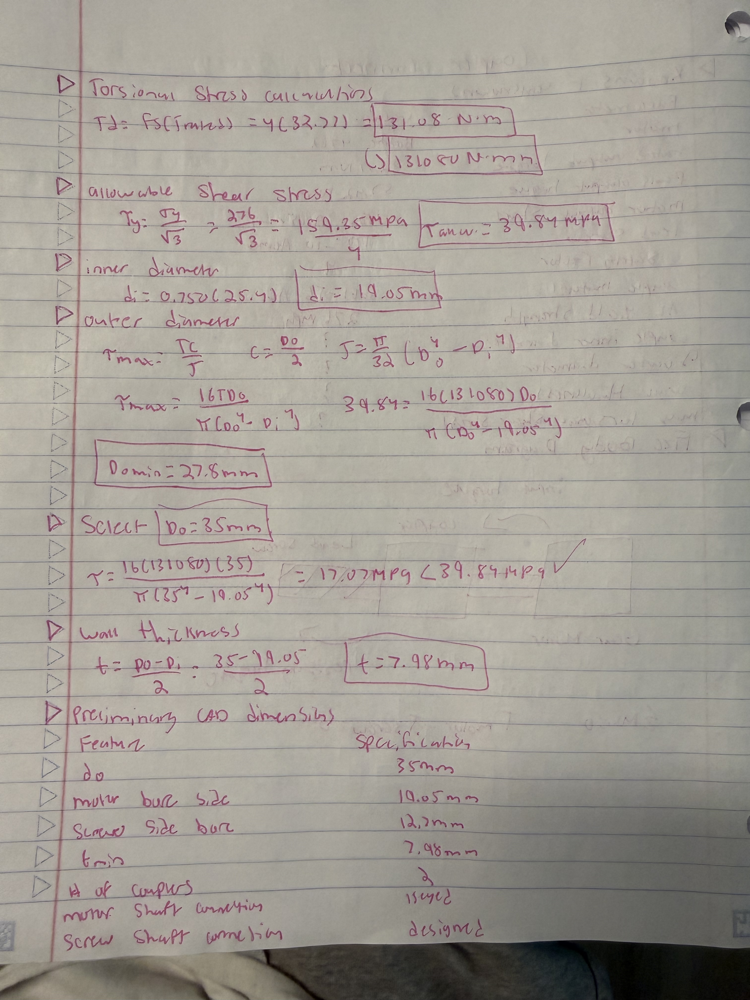
  </figure>

  <h4>I. Preliminary Design Specifications</h4>

  <table border="1" cellpadding="8">
    <tr><th>Feature</th><th>Specification</th></tr>
    <tr><td>Material</td>
        <td>6061-T6 Aluminum</td></tr>
    <tr><td>Outside Diameter</td><td>35 mm</td></tr>
    <tr><td>Motor-Side Bore</td><td>19.05 mm</td></tr>
    <tr><td>Lead Screw Side</td>
        <td>Machined shaft journal required</td></tr>
    <tr><td>Connection Method</td>
        <td>To be finalized</td></tr>
    <tr><td>Quantity</td><td>2</td></tr>
  </table>

  <h4>J. Engineering Conclusion</h4>

  

    A preliminary 35 mm outside diameter
    aluminum coupler was selected.
  

  

    At a design torque of 131.08 N&#183;m,
    the idealized maximum torsional shear stress
    is approximately 17.07 MPa, below the
    estimated material shear yield strength
    of 159.35 MPa.
  

  

    This calculation assumes an uninterrupted
    hollow circular section. Keyways, set screws,
    shaft engagement, stress concentrations,
    misalignment, and the actual machined lead screw
    journal must still be verified before fabrication.
  

</section>

<section id="frame-connection-analysis">

  <h3>4. Frame Connections and Twisting Analysis</h3>

  

    The tensile testing machine uses heavy-duty
    40-series aluminum T-slot extrusions to form
    its supporting frame.
  

  

    The upper frame connections must resist the
    reaction torque transmitted by the motors while
    maintaining alignment of the two Acme lead screws.
  

  

    Preliminary calculations were performed to estimate
    frame twisting loads and identify suitable
    connection hardware.
  

  <figure>
    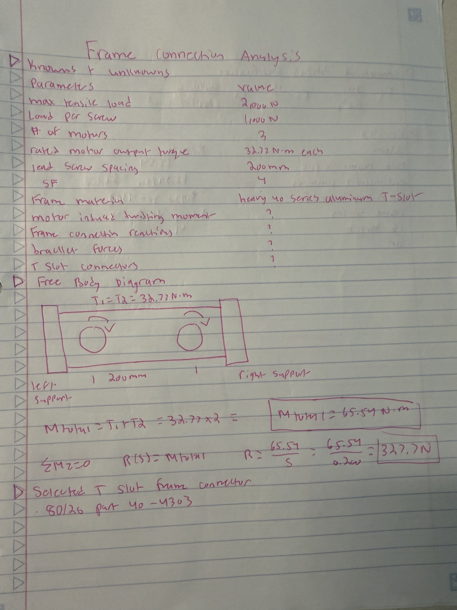
  </figure>

  <h4>A. Known Values</h4>

  <table border="1" cellpadding="8">
    <tr><th>Parameter</th><th>Value</th></tr>
    <tr><td>Frame Material</td>
        <td>40-Series Aluminum T-Slot</td></tr>
    <tr><td>Motor Quantity</td><td>2</td></tr>
    <tr><td>Rated Torque per Motor</td>
        <td>32.77 N&#183;m</td></tr>
    <tr><td>Estimated Operating Torque per Screw</td>
        <td>1.30 N&#183;m</td></tr>
    <tr><td>Preliminary Force Couple Spacing</td>
        <td>200 mm</td></tr>
    <tr><td>Proposed Bracket</td>
        <td>80/20 Part 40-4303</td></tr>
    <tr><td>Proposed Bracket Quantity</td>
        <td>4</td></tr>
  </table>

  

    The 200 mm distance is an assumed effective
    moment-resisting lever arm. The actual connection
    spacing must be confirmed from the CAD assembly.
  

  <h4>B. Total Motor Reaction Torque</h4>

  

    For a conservative preliminary loading case,
    assume both motors transmit rated torque
    in the same rotational direction.
  

  

    Mtotal = T1 + T2
  

  

    Mtotal = 32.77 + 32.77
  

  

    <strong>Mtotal = 65.54 N&#183;m</strong>
  

  

    The corresponding estimated normal operating
    torque is:
  

  

    Moperating = 2 &times; 1.30
  

  

    <strong>Moperating = 2.60 N&#183;m</strong>
  

  

    The rated-torque case was used to investigate
    a more conservative frame loading condition.
  

  <h4>C. Equivalent Connection Reaction Force</h4>

  

    Approximate the twisting moment as a pair
    of equal and opposite forces separated by
    an effective distance S.
  

  

    M = R &times; S
  

  

    R = M / S
  

  

    Assumed spacing:
  

  
S = 200 mm = 0.200 m

  

    R = 65.54 / 0.200
  

  

    <strong>R = 327.7 N</strong>
  

  

    Therefore, the preliminary rated-torque
    load case corresponds to an equivalent
    force couple of 327.7 N.
  

  

    This is an equivalent static reaction estimate.
    It is not necessarily the load carried by
    an individual bracket or bolt.
  

  <h4>D. Frame Connection Free-Body Diagram</h4>

  <figure>
    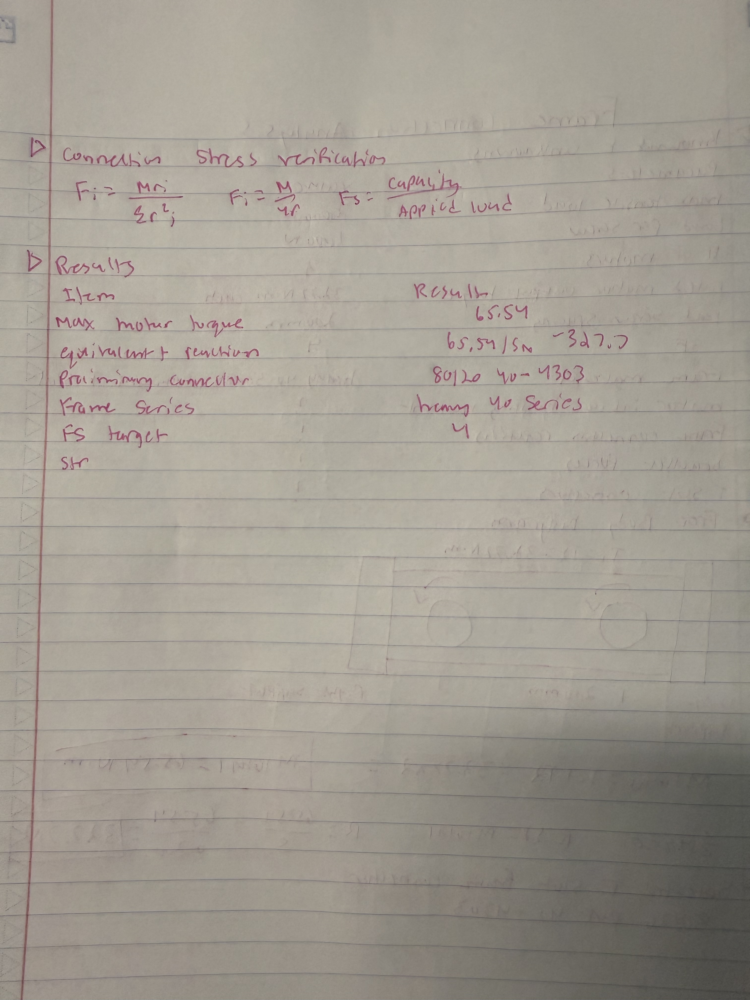
  </figure>

  <h4>E. Connection Bolt Group Analysis</h4>

  

    For a bolt group subjected to an in-plane
    moment, a preliminary elastic distribution
    of the moment-induced shear force is:
  

  

    Fi =
    M &times; ri /
    &Sigma;(rj2)
  

  
Where:

  <ul>
    <li>
      Fi = moment-induced force at bolt i
    </li>
    <li>
      M = moment acting on the bolt group
    </li>
    <li>
      ri = distance from the bolt
      group centroid to bolt i
    </li>
    <li>
      &Sigma;(rj2) =
      sum of squared bolt distances
    </li>
  </ul>

  

    A numerical bolt-group force cannot be
    finalized until the actual bracket locations,
    number of bolts, and load distribution are
    established in CAD.
  

  <h4>F. Preliminary Bracket Selection</h4>

  

    The proposed connection uses the 80/20
    heavy-duty four-hole inside corner bracket,
    part number 40-4303.
  

  

    Four brackets are included in the preliminary
    parts list to reinforce the upper frame
    connections.
  

  <table border="1" cellpadding="8">
    <tr><th>Feature</th><th>Specification</th></tr>
    <tr><td>Bracket Manufacturer</td><td>80/20</td></tr>
    <tr><td>Bracket Part Number</td><td>40-4303</td></tr>
    <tr><td>Bracket Type</td>
        <td>Four-Hole Wide Inside Corner</td></tr>
    <tr><td>Proposed Quantity</td><td>4</td></tr>
    <tr><td>Frame Type</td>
        <td>Heavy 40-Series T-Slot</td></tr>
    <tr><td>Fasteners</td>
        <td>Compatible T-slot hardware, TBD</td></tr>
  </table>

  <h4>G. Factor of Safety Requirement</h4>

  

    The target factor of safety for the
    design is 4.
  

  

    FS = Connection Capacity / Applied Load
  

  

    For the preliminary force-couple model,
    the relevant applied force is 327.7 N.
  

  

    To meet a factor of safety of 4 in
    this simplified loading model:
  

  

    Required Capacity = 4 &times; 327.7
  

  

    <strong>
      Required Capacity = 1310.8 N
    </strong>
  

  

    This value is the required capacity for
    the modeled reaction force, not an
    independently verified manufacturer
    rating for the selected bracket.
  

  

    A completed connection safety-factor check
    requires the actual load path and published
    bracket, fastener, and T-slot connection
    capacities.
  

  <h4>H. Engineering Conclusion</h4>

  

    The combined rated motor reaction torque
    is estimated as 65.54 N&#183;m.
  

  

    Using an assumed 200 mm effective lever
    arm, this corresponds to an equivalent
    reaction force of 327.7 N.
  

  

    Four 80/20 part 40-4303 corner brackets
    are proposed for the upper frame.
  

  

    Final verification of bracket capacity,
    fastener shear, T-slot resistance,
    extrusion twisting, and the factor of
    safety must be completed using the
    actual CAD geometry and manufacturer data.
  

</section>

<section id="top-frame-fea">

  <h3>5. Top Horizontal Frame FEA</h3>

  

    Finite Element Analysis (FEA) was performed
    in SolidWorks Simulation on the top horizontal
    frame member of the tensile testing machine.
  

  

    The purpose of this analysis was to evaluate
    stress distribution and determine whether
    the frame member satisfies the required
    factor of safety of 4.
  

  <h4>A. Simulation Setup</h4>

  

    The simulation model represents a horizontal
    T-slot aluminum frame member with loads
    applied near the motor mounting locations.
  

  

    The screenshots show restrained regions
    at the beam ends and loads applied near
    two mounting holes.
  

  

    The simulation identifies a material yield
    strength of 215 MPa. The exact material
    assignment, applied force magnitudes,
    torque values, and boundary conditions
    should be verified against the saved
    SolidWorks simulation study.
  

  <h4>B. Coarse Mesh Stress Analysis</h4>

  <figure>
    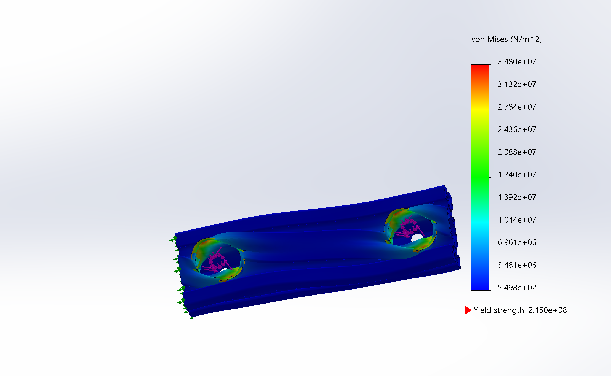
    <figcaption>
      Figure F1. Coarse mesh von Mises
      stress distribution.
    </figcaption>
  </figure>

  

    Maximum von Mises stress:
  

  

    <strong>34.80 MPa</strong>
  

  

    The greatest stress concentrations appear
    near the loaded mounting holes.
  

  <h4>C. Balanced Mesh Stress Analysis</h4>

  <figure>
    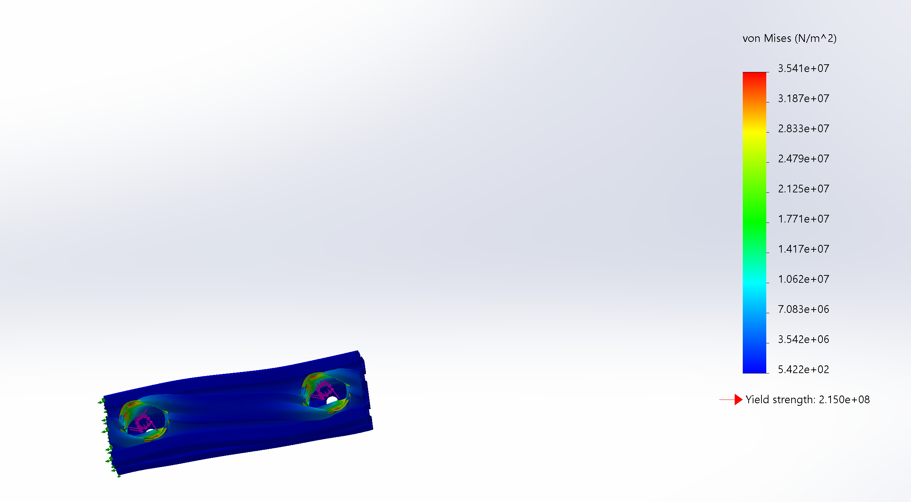
    <figcaption>
      Figure F2. Balanced mesh von Mises
      stress distribution.
    </figcaption>
  </figure>

  

    Maximum von Mises stress:
  

  

    <strong>35.41 MPa</strong>
  

  <h4>D. Fine Mesh Stress Analysis</h4>

  <figure>
    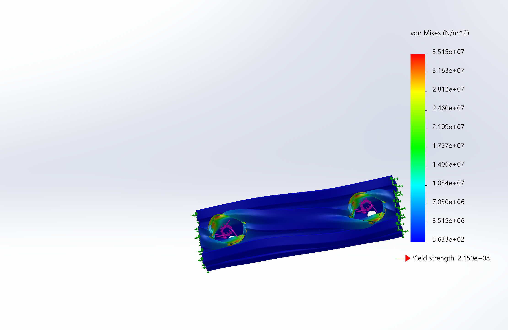
    <figcaption>
      Figure F3. Fine mesh von Mises
      stress distribution.
    </figcaption>
  </figure>

  

    Maximum von Mises stress:
  

  

    <strong>35.15 MPa</strong>
  

  

    The fine mesh shows stress concentrations
    near the mounting holes, while most
    of the beam has considerably lower stress.
  

  <h4>E. Mesh Convergence Comparison</h4>

  <table border="1" cellpadding="8">
    <tr>
      <th>Mesh</th>
      <th>Maximum Stress</th>
    </tr>
    <tr>
      <td>Coarse</td>
      <td>34.80 MPa</td>
    </tr>
    <tr>
      <td>Balanced</td>
      <td>35.41 MPa</td>
    </tr>
    <tr>
      <td>Fine</td>
      <td>35.15 MPa</td>
    </tr>
  </table>

  

    Percent difference between balanced
    and fine mesh stress results:
  

  

    Difference =
    |35.41 - 35.15| / 35.15 x 100
  

  

    <strong>Difference = 0.74%</strong>
  

  

    The maximum stresses are relatively
    consistent across all three mesh settings.
  

  

    This provides preliminary evidence of
    stress-result convergence. A complete
    mesh convergence study should additionally
    report element sizes or element counts
    and confirm consistent loading and
    boundary conditions.
  

  <h4>F. Factor of Safety Analysis</h4>

  

    The factor of safety was evaluated
    relative to yielding.
  

  

    FS = Yield Strength / Maximum Stress
  

  

    Yield strength = 215 MPa
  

  

    Fine mesh maximum stress = 35.15 MPa
  

  

    FS = 215 / 35.15
  

  

    <strong>FS = 6.12</strong>
  

  

    Required factor of safety = 4
  

  

    <strong>6.12 &gt; 4</strong>
  

  

    Therefore, the modeled top horizontal
    frame meets the target factor of
    safety under the simulated loading.
  

  <h4>G. Factor of Safety Results</h4>

  <figure>
    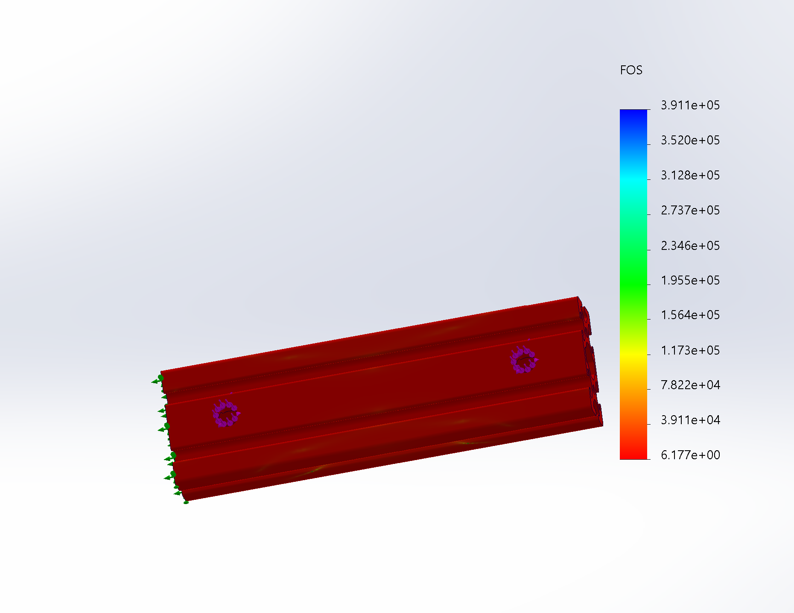
    <figcaption>
      Figure F4. Coarse mesh factor
      of safety distribution.
    </figcaption>
  </figure>

  <figure>
    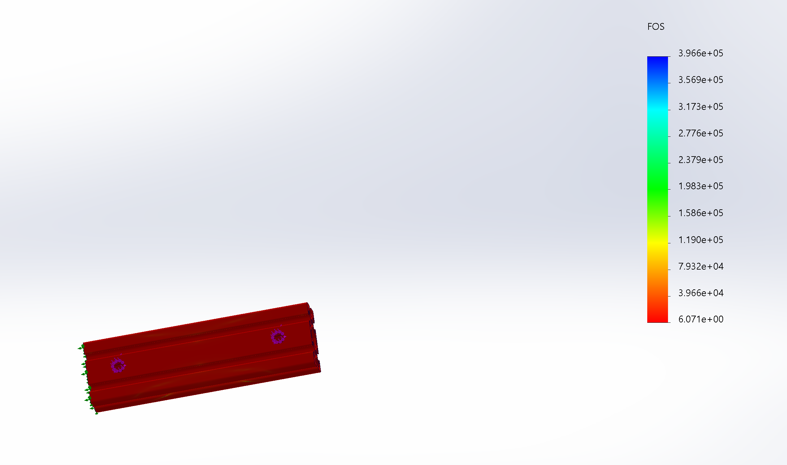
    <figcaption>
      Figure F5. Balanced mesh factor
      of safety distribution.
    </figcaption>
  </figure>

  <figure>
    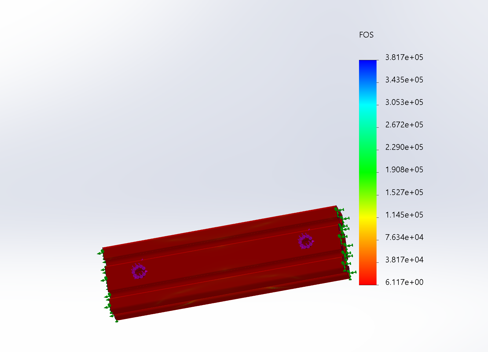
    <figcaption>
      Figure F6. Fine mesh factor
      of safety distribution.
    </figcaption>
  </figure>

  <table border="1" cellpadding="8">
    <tr>
      <th>Mesh</th>
      <th>Approx. Minimum FS</th>
    </tr>
    <tr>
      <td>Coarse</td>
      <td>6.18</td>
    </tr>
    <tr>
      <td>Balanced</td>
      <td>6.07</td>
    </tr>
    <tr>
      <td>Fine</td>
      <td>6.12</td>
    </tr>
  </table>

  

    The minimum factors of safety shown
    in all three simulation screenshots
    exceed the required value of 4.
  

  <h4>H. Displacement Verification</h4>

  

    A numerical displacement result for
    the isolated top beam was not included
    among the supplied screenshots.
  

  

    The maximum displacement and its
    location should be added from the
    SolidWorks simulation study.
  

  <h4>I. Engineering Conclusion</h4>

  

    The fine mesh simulation reported a
    maximum von Mises stress of 35.15 MPa
    and a minimum factor of safety of
    approximately 6.12.
  

  

    The balanced and fine mesh stress
    results differed by approximately
    0.74 percent, suggesting that the
    reported maximum stress is reasonably
    stable across these mesh settings.
  

  

    The frame passes the preliminary
    strength check for the modeled
    loading conditions.
  

  

    Final validation requires confirmation
    of the applied loads, supports,
    mesh settings, and displacement
    results in SolidWorks.
  

</section>

<section id="vertical-frame-fea">

  <h3>6. Vertical Frame FEA</h3>

  

    Finite Element Analysis was performed in
    SolidWorks Simulation on the supporting frame
    of the tensile testing machine.
  

  

    The purpose of this analysis was to examine
    stress distribution throughout the frame,
    including the vertical support members,
    under the applied loading conditions.
  

  <h4>A. Frame Model and Loading</h4>

  

    The frame consists of vertical aluminum
    T-slot extrusion members connected by
    upper and lower horizontal supports.
  

  

    The provided simulation screenshots show
    applied loads near the motor mounting
    locations on the upper horizontal member.
  

  

    Restraints are visible near the base
    of the frame.
  

  <figure>
    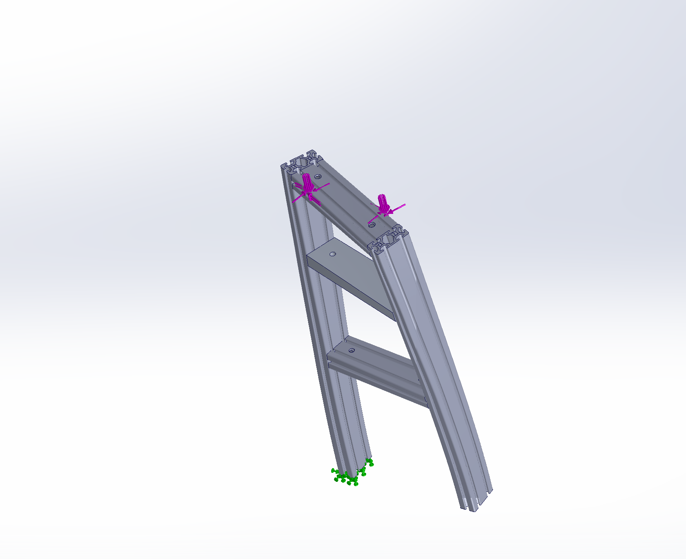
    <figcaption>
      Figure V1. Frame simulation model showing
      loading locations and support restraints.
    </figcaption>
  </figure>

  

    The image illustrates the simulation setup.
    It does not provide a numerical displacement
    result.
  

  <h4>B. Von Mises Stress Analysis</h4>

  

    The provided full-frame simulation shows
    the von Mises stress distribution across
    the supporting structure.
  

  <figure>
    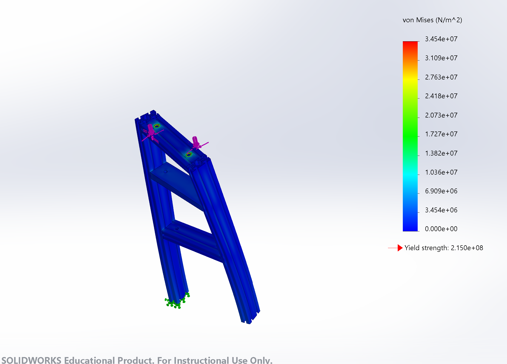
    <figcaption>
      Figure V2. Coarse mesh stress analysis
      of the complete supporting frame.
    </figcaption>
  </figure>

  

    Maximum von Mises stress:
  

  

    <strong>
      Maximum Stress = 34.54 MPa
    </strong>
  

  

    The highest stresses appear near the
    loaded regions of the upper horizontal
    frame member.
  

  

    Most of the vertical frame members
    appear blue in the stress plot,
    indicating comparatively lower stresses
    within the displayed color scale.
  

  

    The 34.54 MPa maximum applies to the
    full-frame model. It should not be
    interpreted as a separately measured
    maximum stress in the vertical members.
  

  <h4>C. Material Yield Strength</h4>

  

    The SolidWorks stress plot identifies
    the material yield strength as:
  

  

    <strong>
      Yield Strength = 215 MPa
    </strong>
  

  <h4>D. Factor of Safety Calculation</h4>

  

    The estimated factor of safety
    against yielding is calculated using:
  

  

    FS = Yield Strength / Maximum Stress
  

  

    FS = 215 / 34.54
  

  

    <strong>FS = 6.22</strong>
  

  

    Required factor of safety:
  

  
<strong>FS(required) = 4</strong>

  

    Comparison:
  

  
<strong>6.22 &gt; 4</strong>

  

    The full-frame model therefore satisfies
    the preliminary yield-strength criterion
    under the simulated loading conditions.
  

  <h4>E. Mesh Analysis</h4>

  

    The available full-frame stress screenshot
    corresponds to a coarse mesh simulation.
  

  

    A separate balanced and fine mesh
    comparison for the complete frame
    was not included in the provided files.
  

  

    Therefore, numerical mesh convergence
    for the vertical frame analysis
    cannot be established from the
    available screenshots.
  

  <h4>F. Displacement Analysis</h4>

  

    The supplied frame images show the
    geometry, applied loads, and constraints,
    but do not display a numerical
    displacement contour result.
  

  

    Consequently, the maximum displacement
    of the vertical supports cannot
    be reported from the available data.
  

  <h4>G. Engineering Conclusion</h4>

  

    The full-frame SolidWorks simulation
    reported a maximum von Mises stress
    of approximately 34.54 MPa.
  

  

    Using the material yield strength
    of 215 MPa shown in the simulation,
    the estimated factor of safety
    against yielding is 6.22.
  

  

    This exceeds the required factor
    of safety of 4 for the modeled
    static loading conditions.
  

  

    The available results provide
    preliminary evidence that the
    overall frame can withstand the
    simulated loads without yielding.
  

  

    However, vertical-member-specific
    results, displacement values,
    mesh convergence, and possible
    buckling behavior require further
    verification before the structure
    can be considered fully validated.
  

</section>

<section id="floating-bearing-analysis">

  <h3>7. Floating Bearing Mount Design</h3>

  

    Two floating bearing mounts are proposed for
    the lower ends of the Acme lead screws in the
    tensile testing machine.
  

  

    The upper fixed bearing supports are intended
    to carry the axial thrust loads, while the lower
    floating bearings provide radial support and
    allow axial movement caused by thermal expansion
    and manufacturing tolerances.
  

  

    The floating mounts must maintain proper
    alignment without overconstraining the
    lead screws.
  

  <figure>
    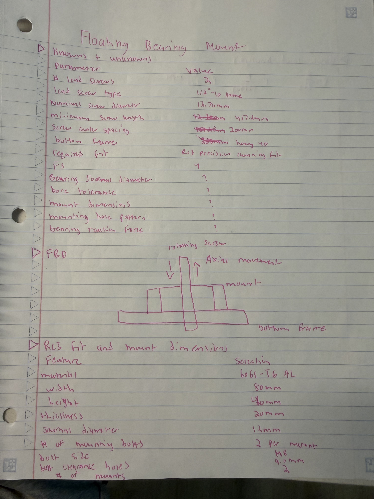
  </figure>

  <h4>A. Preliminary Design Specifications</h4>

  <table border="1" cellpadding="8">
    <tr><th>Parameter</th><th>Value</th></tr>
    <tr><td>Number of Floating Mounts</td>
        <td>2</td></tr>
    <tr><td>Support Material</td>
        <td>6061-T6 Aluminum</td></tr>
    <tr><td>Proposed Mount Length</td>
        <td>80 mm</td></tr>
    <tr><td>Proposed Mount Width</td>
        <td>40 mm</td></tr>
    <tr><td>Proposed Mount Thickness</td>
        <td>20 mm</td></tr>
    <tr><td>Proposed Shaft Journal Diameter</td>
        <td>12 mm</td></tr>
    <tr><td>Proposed Mounting Bolts</td>
        <td>2 M8 per mount</td></tr>
    <tr><td>Proposed Bolt Clearance Holes</td>
        <td>9 mm</td></tr>
    <tr><td>Requested Fit Classification</td>
        <td>RC3</td></tr>
  </table>

  

    These dimensions are preliminary and must
    be checked against the final bearing selection,
    lead screw end machining, and CAD assembly.
  

  <h4>B. Fixed and Floating Bearing Arrangement</h4>

  

    The lead screw support arrangement uses
    two different bearing functions:
  

  <ul>
    <li>
      Fixed bearing support: locates the screw
      axially and carries thrust loads.
    </li>
    <li>
      Floating bearing support: supports radial
      loading while allowing axial displacement.
    </li>
  </ul>

  

    This prevents the lead screw from being
    constrained axially at both ends.
  

  <h4>C. Shaft Journal Design</h4>

  

    The Acme lead screw has a nominal outside
    diameter of 12.7 mm.
  

  

    A proposed 12 mm diameter machined journal
    is used at the floating bearing location.
  

  

    <strong>
      djournal = 12 mm
    </strong>
  

  

    The bearing must contact the smooth
    machined journal rather than the
    Acme screw threads.
  

  

    Final journal length, shoulder geometry,
    surface finish, and bearing engagement
    must be determined after selecting
    the actual bearing.
  

  <h4>D. RC3 Running Fit</h4>

  

    An RC3 precision running fit is proposed
    for the shaft and mating bore where
    relative sliding or rotation is intended.
  

  

    Diametral clearance is calculated by:
  

  

    C = Dbore - dshaft
  

  

    Minimum clearance:
  

  

    Cmin =
    Dbore,min -
    dshaft,max
  

  

    Maximum clearance:
  

  

    Cmax =
    Dbore,max -
    dshaft,min
  

  

    The exact RC3 limits for the selected
    nominal diameter must be taken from
    the applicable ANSI B4.1 fit table.
  

  

    <strong>
      [INSERT VERIFIED RC3 SHAFT AND BORE
      TOLERANCE TABLE HERE]
    </strong>
  

  

    The exact minimum and maximum shaft and
    bore dimensions have not yet been
    established. The final drawing must
    specify both sets of limits.
  

  

    If a rolling-element bearing is selected,
    its shaft and housing fits must instead
    be checked against the bearing
    manufacturer's recommendations.
  

  <h4>E. Floating Bearing Free-Body Diagram</h4>

  <figure>
    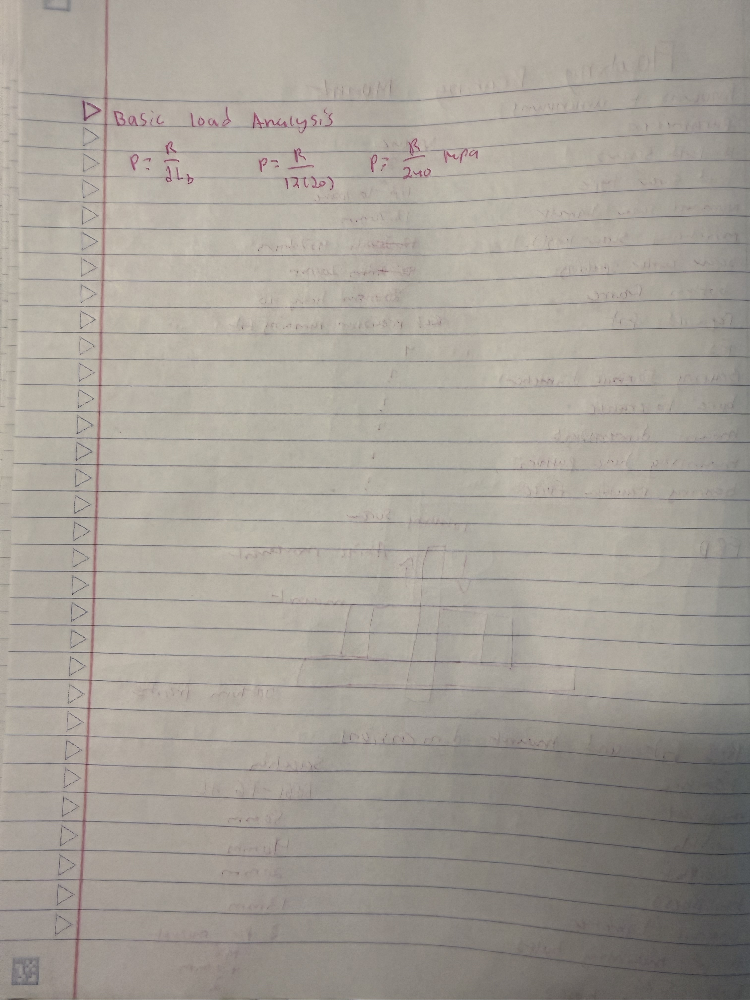
  </figure>

  

    The floating bearing provides radial
    reactions but is not intended to
    carry the primary axial thrust.
  

  

    The actual radial reaction must be
    determined from the complete lead screw
    loading and support geometry.
  

  <h4>F. Bearing Pressure Calculation</h4>

  

    For a preliminary plain-bearing model,
    projected bearing pressure is:
  

  

    p = R / (dLb)
  

  
Where:

  <ul>
    <li>R = radial bearing reaction (N)</li>
    <li>d = journal diameter (mm)</li>
    <li>
      Lb = effective bearing
      contact length (mm)
    </li>
  </ul>

  

    For an illustrative 12 mm journal and
    20 mm effective bearing length:
  

  

    p = R / (12 &times; 20)
  

  

    <strong>p = R / 240 MPa</strong>
  

  

    In this expression, R is entered in
    newtons and the resulting pressure
    is in N/mm2, or MPa.
  

  

    A numerical pressure cannot be completed
    until the actual radial reaction and
    bearing contact length are confirmed.
  

  <h4>G. Mounting Arrangement</h4>

  

    Each floating support is preliminarily
    attached to the lower frame using
    two M8 fasteners.
  

  

    Proposed bolt clearance hole diameter:
  

  

    <strong>dhole = 9 mm</strong>
  

  

    Fastener spacing, edge distances, and
    attachment to the 40-series extrusion
    must be finalized in CAD.
  

  <h4>H. Preliminary Design Summary</h4>

  <table border="1" cellpadding="8">
    <tr><th>Feature</th><th>Selection</th></tr>
    <tr><td>Mount Material</td>
        <td>6061-T6 Aluminum</td></tr>
    <tr><td>Mount Dimensions</td>
        <td>80 x 40 x 20 mm (preliminary)</td></tr>
    <tr><td>Journal Diameter</td>
        <td>12 mm (preliminary)</td></tr>
    <tr><td>Fit Type</td>
        <td>RC3 proposed, limits pending</td></tr>
    <tr><td>Mounting Hardware</td>
        <td>2 M8 bolts per mount</td></tr>
    <tr><td>Quantity</td><td>2</td></tr>
  </table>

  <h4>I. Engineering Conclusion</h4>

  

    Two lower floating bearing mounts are
    proposed to support the Acme lead screws
    while permitting axial displacement.
  

  

    A preliminary 6061-T6 aluminum mounting
    block measuring 80 x 40 x 20 mm was
    selected, with a proposed 12 mm
    machined lead screw journal.
  

  

    The actual bearing type, radial load,
    required RC3 dimensional limits, and
    mount strength must still be verified
    before fabrication.
  

</section>

<section id="cost-analysis">

  <h3>8. Combined A10/A11 Bill of Materials and Cost Analysis</h3>

  

    A preliminary bill of materials (BOM) was
    developed for the 2 kN tensile testing machine.
    The BOM combines components selected during
    A10 and A11, including the frame, Acme lead screws,
    drive motors, couplers, mounting brackets,
    and bearing supports.
  

  

    Purchased components, custom-fabricated parts,
    and estimated labor are considered separately.
    Some component prices and manufacturing
    requirements remain to be finalized.
  

  <h4>A. Purchased Components</h4>

  <table border="1" cellpadding="8">
    <tr>
      <th>Component</th>
      <th>Qty.</th>
      <th>Unit Cost</th>
      <th>Total</th>
    </tr>
    <tr>
      <td>Bodine 4762 Gearmotor</td>
      <td>2</td>
      <td>$1,145.44</td>
      <td>$2,290.88</td>
    </tr>
    <tr>
      <td>Roton 59284 Acme Lead Screw</td>
      <td>3 ft total</td>
      <td>$9.10/ft</td>
      <td>$27.30</td>
    </tr>
    <tr>
      <td>Roton 90222 Bronze Nut</td>
      <td>2</td>
      <td>$23.57</td>
      <td>$47.14</td>
    </tr>
    <tr>
      <td>80/20 40-4303 Corner Bracket</td>
      <td>4</td>
      <td>$8.79</td>
      <td>$35.16</td>
    </tr>
    <tr>
      <td colspan="3">
        <strong>Priced Components Subtotal</strong>
      </td>
      <td><strong>$2,400.48</strong></td>
    </tr>
  </table>

  

    The listed prices are preliminary estimates
    and should be verified with current supplier
    quotations before final purchasing.
  

  

    The 3 ft lead screw estimate assumes two
    18-inch pieces can be obtained without
    additional material or cutting allowances.
  

  <h4>B. Frame Material Cost</h4>

  

    Heavy 40-series aluminum T-slot extrusion
    was selected for the supporting frame.
  

  
Estimated total extrusion length:

  
<strong>L = 2160 mm</strong>

  
Estimated cost per millimeter:

  
<strong>C = $0.0821/mm</strong>

  
Material cost:

  
Cmaterial = L &times; C

  
Cmaterial = 2160 &times; 0.0821

  
<strong>Cmaterial = $177.34</strong>

  
Estimated cutting cost:

  
4 cuts &times; $3.79/cut = $15.16

  
Total estimated frame cost:

  
Cframe = 177.34 + 15.16

  
<strong>Cframe = $192.50</strong>

  

    The 2160 mm frame length and number of
    cuts are preliminary assumptions.
    The final material cost must be updated
    from the completed CAD frame dimensions.
  

  <h4>C. Additional Components Requiring Pricing</h4>

  <table border="1" cellpadding="8">
    <tr>
      <th>Component</th>
      <th>Qty.</th>
      <th>Status</th>
    </tr>
    <tr>
      <td>Roton 89838 Nut Mounting Flanges</td>
      <td>2</td>
      <td>Price pending</td>
    </tr>
    <tr>
      <td>Custom Crosshead</td>
      <td>1</td>
      <td>Material and machining cost pending</td>
    </tr>
    <tr>
      <td>Motor Mounting Brackets</td>
      <td>2</td>
      <td>Material and fabrication cost pending</td>
    </tr>
    <tr>
      <td>Motor-to-Lead-Screw Couplers</td>
      <td>2</td>
      <td>Material and fabrication cost pending</td>
    </tr>
    <tr>
      <td>Floating Bearing Mounts</td>
      <td>2</td>
      <td>Material and fabrication cost pending</td>
    </tr>
    <tr>
      <td>Fixed Bearing Supports</td>
      <td>2</td>
      <td>Selection and pricing pending</td>
    </tr>
    <tr>
      <td>Bearings</td>
      <td>TBD</td>
      <td>Selection and pricing pending</td>
    </tr>
    <tr>
      <td>Specimen Grips</td>
      <td>2 sets</td>
      <td>Selection and pricing pending</td>
    </tr>
    <tr>
      <td>Fasteners and T-Slot Hardware</td>
      <td>TBD</td>
      <td>Quantity and pricing pending</td>
    </tr>
  </table>

  

    These components must be included in the
    final complete BOM. The current subtotal
    does not include their costs.
  

  <h4>D. Labor Cost Analysis</h4>

  

    The assignment specifies a labor rate
    of $35 per hour.
  

  

    Labor Cost = Total Hours &times; Hourly Rate
  

  

    For a preliminary example, assume
    20 total engineering and fabrication hours:
  

  
Labor Cost = 20 &times; $35

  
<strong>Estimated Labor Cost = $700.00</strong>

  

    The 20-hour value is an example only.
    It must be replaced with the team's
    actual recorded engineering, CAD,
    analysis, and fabrication hours.
  

  <h4>E. Preliminary Cost Summary</h4>

  <table border="1" cellpadding="8">
    <tr>
      <th>Category</th>
      <th>Estimated Cost</th>
    </tr>
    <tr>
      <td>Priced Purchased Components</td>
      <td>$2,400.48</td>
    </tr>
    <tr>
      <td>Estimated Frame Material and Cuts</td>
      <td>$192.50</td>
    </tr>
    <tr>
      <td>Example Labor Estimate</td>
      <td>$700.00</td>
    </tr>
    <tr>
      <td>
        <strong>Preliminary Partial Total</strong>
      </td>
      <td><strong>$3,292.98</strong></td>
    </tr>
  </table>

  

    Total = $2,400.48 + $192.50 + $700.00
  

  
<strong>Total = $3,292.98</strong>

  

    This is a partial cost estimate, not
    the complete manufacturing cost.
    Additional components, machining,
    hardware, and actual labor hours
    must be included before the final
    project cost can be determined.
  

  <h4>F. Supporting Documentation</h4>

  

    The final submission should include
    supplier pricing evidence and the
    completed bill of materials.
  

  

    <strong>
      [INSERT SUPPLIER PRICE SCREENSHOTS HERE]
    </strong>
  

  

    <strong>
      [INSERT COMPLETE BOM IMAGE OR TABLE HERE]
    </strong>
  

  <h4>G. Engineering Conclusion</h4>

  

    The preliminary combined A10/A11
    cost estimate is $3,292.98, including
    an illustrative labor allowance.
  

  

    The two Bodine 4762 gearmotors represent
    the largest identified purchased cost.
  

  

    The final BOM must be updated after
    component selection, CAD verification,
    supplier pricing, and team labor
    documentation are completed.
  

</section>

## Decide

<section id="cad-design">

  <h2>Design</h2>
  <h3>CAD Modeling and Assembly</h3>

  

    The A11 design builds upon the tensile testing
    machine developed during A10. Additional
    components were modeled in SolidWorks to
    incorporate the motor drive system, motor
    mounting plates, shaft couplers, and
    supporting frame.
  

  

    The CAD models allow the team to visualize
    component positioning, examine mounting
    interfaces, and assess the overall
    assembly configuration.
  

  <h4>A. Selected Motor</h4>

  

    The proposed drive system uses two Bodine
    Electric Model 4762 DC gearmotors, with
    one motor positioned above each lead screw.
  

  

    Motor dimensions and mounting features
    must be checked against the manufacturer
    drawing to ensure proper assembly.
  

  <figure>
    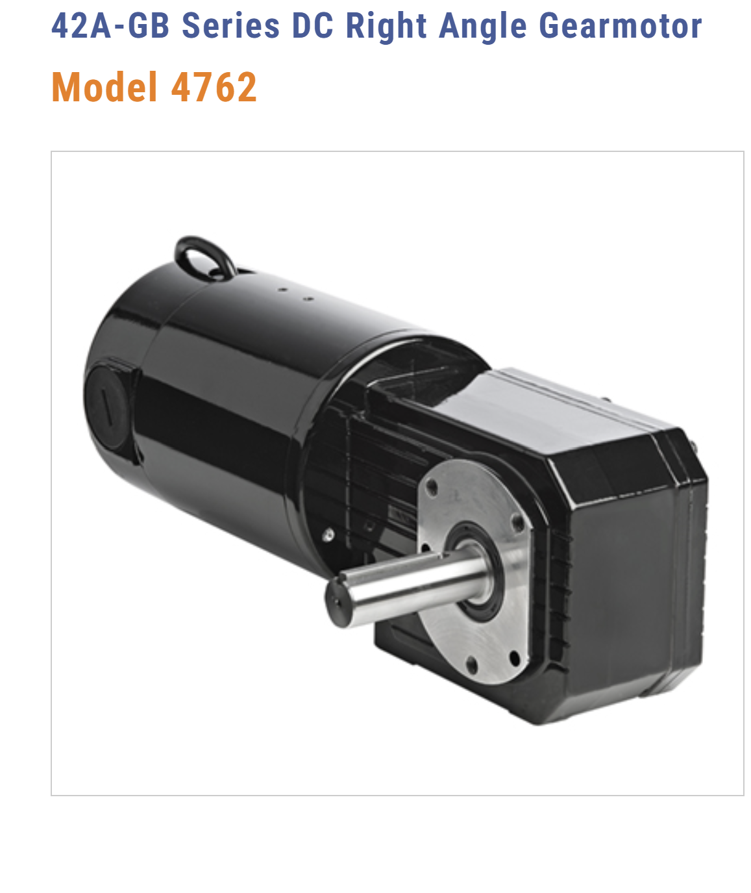
    <figcaption>
      Figure D1. Selected Bodine Electric
      Model 4762 gearmotor.
    </figcaption>
  </figure>

  <h4>B. Motor Mounting Plate</h4>

  

    A mounting plate was modeled to support
    the motor and provide an attachment
    interface to the testing machine frame.
  

  

    The CAD images show the plate geometry,
    mounting hole arrangement, and the
    motor-to-plate interface.
  

  <figure>
    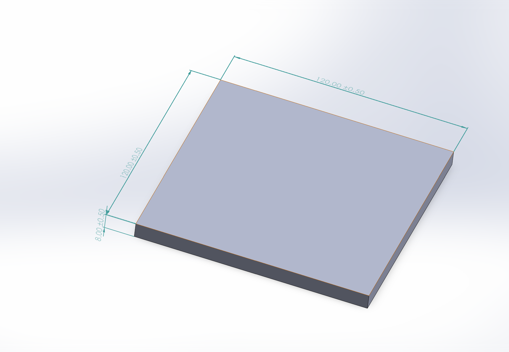
    <figcaption>
      Figure D2. Motor mounting plate model.
    </figcaption>
  </figure>

  <figure>
    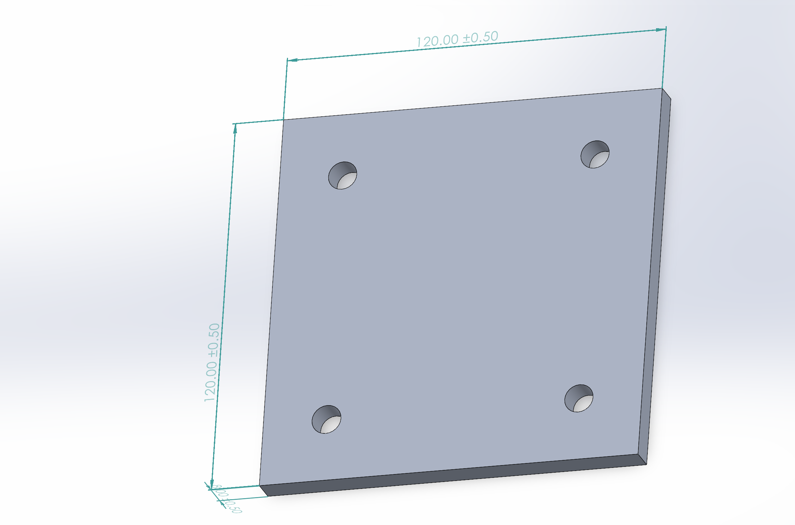
    <figcaption>
      Figure D3. Mounting plate hole layout
      and dimensional features.
    </figcaption>
  </figure>

  <figure>
    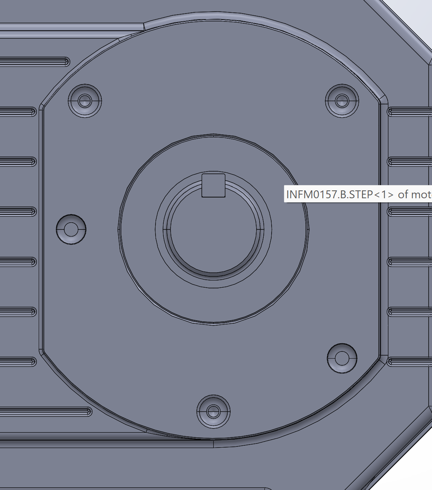
    <figcaption>
      Figure D4. Motor mounting hole
      arrangement.
    </figcaption>
  </figure>

  <figure>
    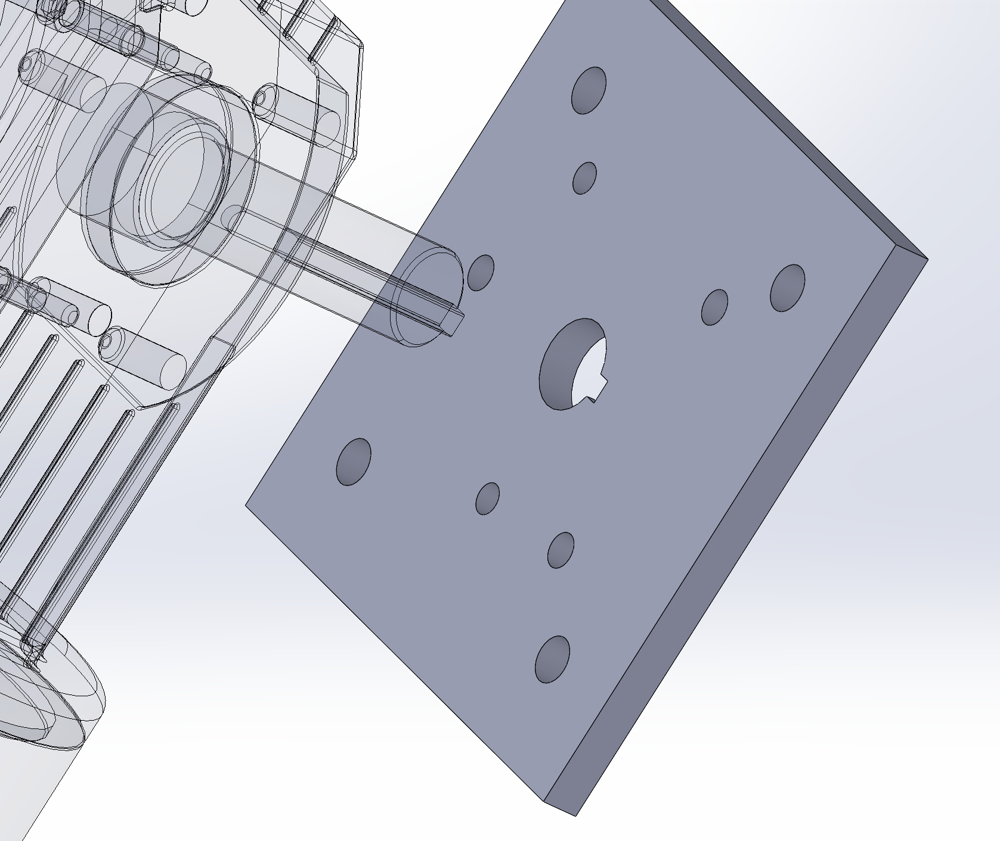
    <figcaption>
      Figure D5. Motor and mounting plate
      attachment alignment.
    </figcaption>
  </figure>

  <figure>
    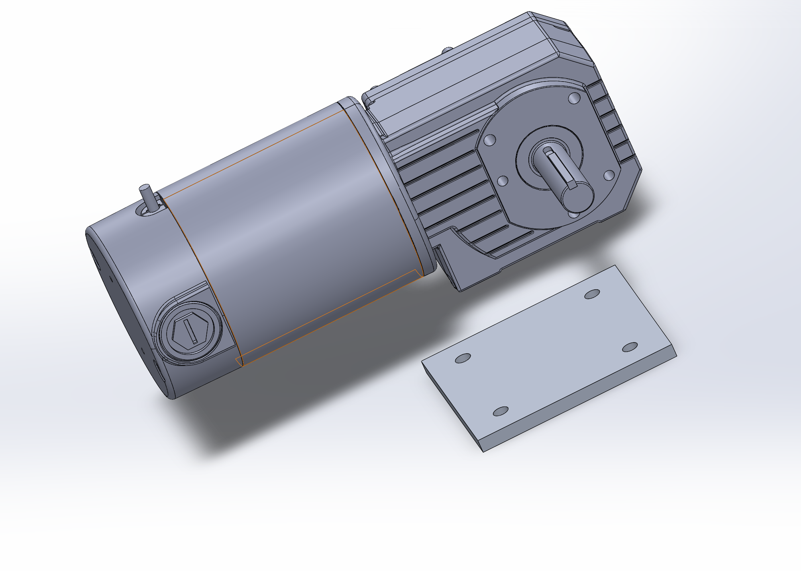
    <figcaption>
      Figure D6. Motor and mounting plate
      CAD components.
    </figcaption>
  </figure>

  <h4>C. Motor Mount Assembly</h4>

  

    The motor and mounting plate were
    assembled to illustrate the proposed
    connection between the motor housing
    and the support structure.
  

  <figure>
    
    <figcaption>
      Figure D7. Motor mounting assembly
      modeled in SolidWorks.
    </figcaption>
  </figure>

  <h4>D. Shaft Coupler</h4>

  

    A shaft coupler was modeled to connect
    the motor output shaft to the lead screw.
  

  

    The CAD model shows a cylindrical body
    with an internal bore and keyway feature.
    The final mating dimensions must match
    the selected motor shaft and machined
    lead screw end.
  

  <figure>
    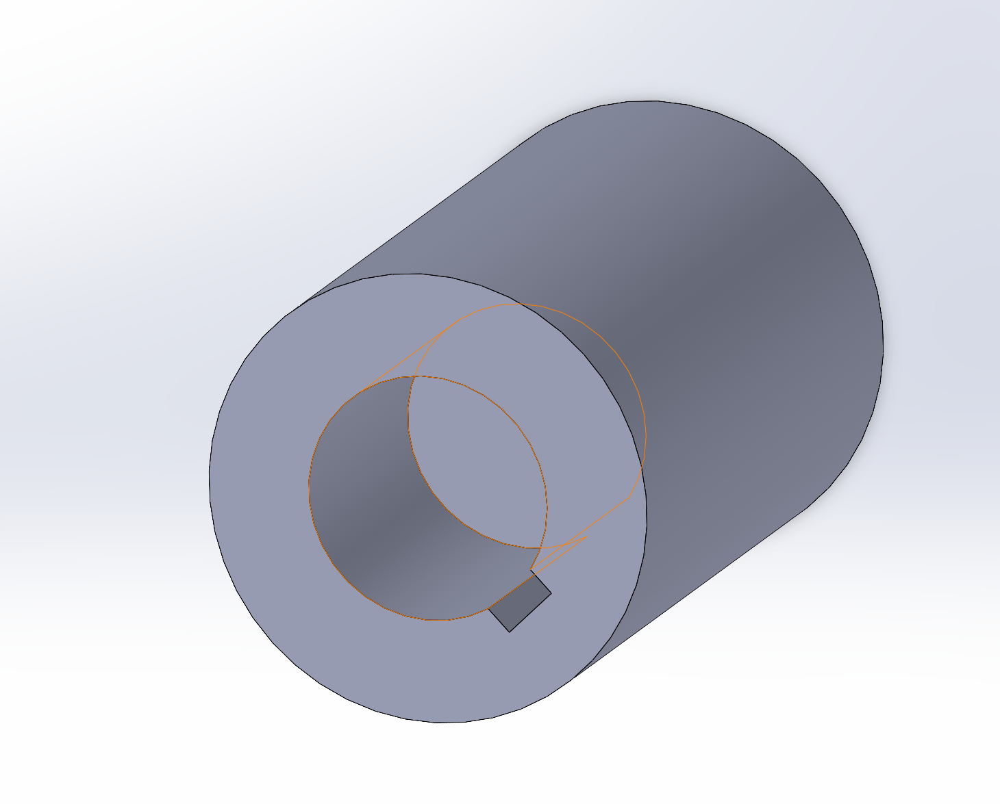
    <figcaption>
      Figure D8. Shaft coupler model.
    </figcaption>
  </figure>

  

    The associated SolidWorks part and
    drawing files are provided with the
    team's CAD deliverables.
  

  <h4>E. Updated Tensile Testing Assembly</h4>

  

    The existing A10 frame assembly was
    updated to incorporate the proposed
    motor arrangement.
  

  

    The assembly image shows two motors
    at the upper portion of the frame,
    with a horizontal crosshead positioned
    between the vertical supports.
  

  <figure>
    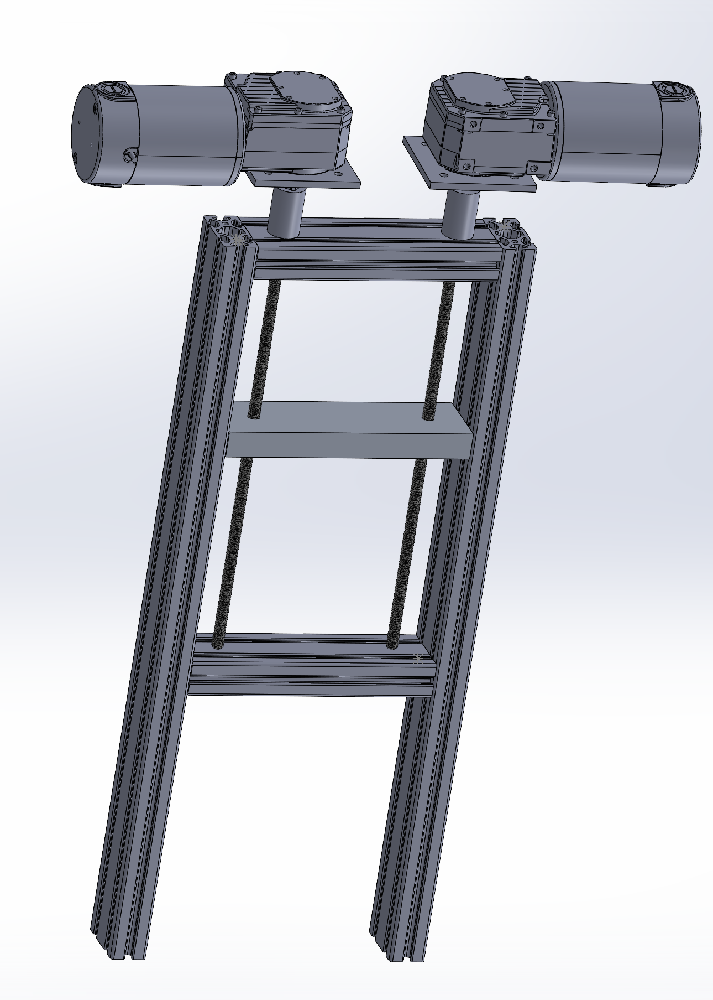
    <figcaption>
      Figure D9. Updated tensile testing
      machine assembly.
    </figcaption>
  </figure>

  <h4>F. Assembly Verification</h4>

  

    The CAD models provide a preliminary
    representation of the motor mounting
    arrangement, coupler design, and
    overall machine configuration.
  

  

    Before fabrication, the final assembly
    must be checked for shaft alignment,
    bearing support locations, fastener
    clearances, crosshead travel, and
    compatibility between mating components.
  

  

    The provided assembly screenshots do
    not independently establish the final
    bearing arrangement or verify all
    mechanical interfaces.
  

  <h4>G. SolidWorks Deliverables</h4>

  

    The CAD package includes the following
    native SolidWorks files:
  

  <ul>
    <li>finalassembly.SLDASM</li>
    <li>motorandbracketassm.SLDASM</li>
    <li>coupler.SLDPRT</li>
    <li>couplerdrawing.SLDDRW</li>
    <li>motordrawing.SLDDRW</li>
  </ul>

  

    These files should be included in the
    downloadable CAD package. Assembly
    dependencies should be checked so the
    models open correctly on another computer.
  

</section>

## Communicate

<section id="communication">

  <h2>Communication and Lessons Learned</h2>

  <h3>Team Member Contributions</h3>

  

    The A11 tensile testing machine project was
    completed through collaboration between
    three team members. Responsibilities were
    divided between engineering analysis,
    CAD modeling, simulation, and documentation.
  

  <table border="1" cellpadding="8">
    <tr>
      <th>Team Member</th>
      <th>Responsibilities</th>
    </tr>
    <tr>
      <td>Mason</td>
      <td>
        Engineering calculations, motor selection,
        motor mounting analysis, coupler analysis,
        frame connection analysis, floating bearing
        analysis, bill of materials, cost analysis,
        and GitHub documentation.
      </td>
    </tr>
    <tr>
      <td>Jakub</td>
      <td>
        CAD modeling, component design, and
        assembly development in SolidWorks.
      </td>
    </tr>
    <tr>
      <td>Amaha</td>
      <td>
        CAD modeling, component design, and
        assembly development in SolidWorks.
      </td>
    </tr>
  </table>

  <h3>Time Spent on Project</h3>

  <table border="1" cellpadding="8">
    <tr>
      <th>Work</th>
      <th>Hours</th>
    </tr>
    <tr>
      <td>CAD Modeling and Assembly
          (Jakub and Amaha combined)</td>
      <td>12 hours</td>
    </tr>
    <tr>
      <td>Engineering Analysis and Documentation
          (Mason)</td>
      <td>To be recorded</td>
    </tr>
  </table>

  

    The labor rate used for the project cost
    analysis is $35 per hour.
  

  

    CAD labor cost = 12 x $35
  

  

    <strong>CAD Labor Cost = $420</strong>
  

  

    The total team labor cost will be updated
    when all individual work hours are recorded.
  

  <h3>Lessons Learned</h3>

  

    One important lesson from A11 was the
    relationship between component selection,
    engineering calculations, and CAD design.
    The motor, couplers, brackets, and bearing
    supports must be compatible for the complete
    machine to function properly.
  

  

    The project also demonstrated the importance
    of using finite element analysis to evaluate
    stresses and factors of safety in structural
    components before manufacturing.
  

  

    Another lesson was the importance of team
    communication. Dividing the engineering
    analysis and CAD responsibilities allowed
    different parts of the design to be developed,
    but required coordination to ensure that
    the final models matched the calculations.
  

  

    Overall, A11 provided experience in
    mechanical design, CAD assembly,
    structural analysis, cost estimation,
    and collaborative engineering.
  

</section>

